# Plan complete du rapport d'activite professionnelle

Objectif : construire un rapport professionnel de 30 pages minimum hors annexes, clair, structure, visuel et suffisamment reflexif pour repondre a la grille d'evaluation.

Ce fichier reprend les informations ajoutees dans `plan-rapport.md`, les reformule dans une langue plus professionnelle et complete les parties qui peuvent l'etre a partir du projet OMtek.

## Page de garde

Elements a faire apparaitre :

- Titre : Rapport d'activite professionnelle.
- Nom et prenom : Longmar Marc.
- Formation : CDAN, Concepteur Developpeur d'Application Numerique.
- Ecole : Ynov.
- Annee scolaire : 2025-2026.
- Entreprise d'accueil : Office Management.
- Adresse : 117 boulevard Beau Rivage Prolongé, 06400 Antibes.
- Periode : du 03/09/2025 au 31/10/2026.
- Service : service IT / technique.
- Tuteur entreprise : Dominique Djoncheere, chef d'entreprise.

Visuel conseille : logo de l'entreprise ou photo sobre liee au domaine bureautique/impression, avec une mise en page professionnelle.

## Remerciements

Remercier brievement :

- le dirigeant de l'entreprise pour la confiance accordee ;
- le tuteur IT pour l'accompagnement et les validations metier ;
- l'equipe technique pour les retours terrain ;
- l'equipe commerciale et administrative pour les informations liees aux clients, au stock et aux processus internes ;
- l'equipe pedagogique pour les apports methodologiques et techniques.

Exemple de formulation :

> Je souhaite remercier l'entreprise Office Management pour son accueil et pour la confiance accordee durant mon alternance. Je remercie particulierement Dominique Djoncheere, chef d'entreprise et tuteur entreprise, pour ses conseils, ses retours et sa disponibilite. Je remercie egalement les equipes technique, commerciale et administrative, dont les echanges m'ont permis de mieux comprendre les besoins metier et les contraintes d'une PME de bureautique.

## Sommaire

Prevoir un sommaire clair avec pagination :

1. Introduction et contexte
2. Developpement : missions et projet OMtek
3. Analyse reflexive et bilan de competences
4. Conclusion et perspectives
5. Annexes

## I. Introduction et contexte

### 1. Presentation generale de l'experience

Mon experience professionnelle s'est deroulee en alternance au sein de l'entreprise Office Management, situee au 117 boulevard Beau Rivage Prolongé a Antibes, du 03/09/2025 au 31/10/2026. J'ai integre le service IT / technique dans une entreprise specialisee dans la vente, la location, l'installation et la maintenance de materiel de bureautique et d'informatique pour les professionnels.

Mes missions initiales concernaient principalement l'installation d'imprimantes et de photocopieurs chez les clients, la configuration des pilotes, la mise en place des carnets d'adresses, ainsi que la configuration des fonctions de numerisation en SMTP ou FTP selon les besoins et les contraintes de chaque client.

Au fil de l'experience, l'analyse des besoins de l'entreprise a fait apparaitre un enjeu plus large : ameliorer le suivi du parc d'imprimantes, centraliser les informations, securiser les donnees et faciliter la gestion des consommables et des interventions. C'est dans ce contexte qu'est ne le projet OMtek.

### 2. Presentation de l'entreprise

Office Management est une PME specialisee dans les solutions de bureautique et d'informatique pour les entreprises. Son activite principale repose sur :

- la vente et la location d'imprimantes, photocopieurs et equipements informatiques ;
- l'installation du materiel chez les clients ;
- la maintenance des imprimantes et photocopieurs ;
- le suivi des consommables ;
- la vente de materiel informatique et de consommables.

L'entreprise fonctionne avec une equipe reduite, ce qui rend l'organisation et la circulation de l'information essentielles. Les roles principaux identifies sont :

- un technicien informatique ;
- un technicien specialise dans la reparation des imprimantes et photocopieurs ;
- un commercial ;
- une personne responsable de la comptabilite et de la gestion du stock ;
- le dirigeant de l'entreprise.

Son statut juridique est une SASU. Cette precision permet de mieux situer le cadre professionnel : il s'agit d'une structure courte, avec des responsabilites concentrees et une forte importance accordee a l'efficacite des processus internes.

L'organisation peut etre presentee autour de trois poles :

- service technique : installation, maintenance, interventions, support client ;
- service commercial : relation client, contrats, ventes ;
- service administratif : facturation, stock, suivi interne.

### 3. Marche et environnement sectoriel

Office Management evolue sur le marche de la bureautique professionnelle. Ce secteur est marque par plusieurs enjeux :

- les entreprises clientes attendent une disponibilite rapide du materiel ;
- les pannes ou ruptures de consommables peuvent ralentir l'activite des clients ;
- les delais d'intervention influencent directement la satisfaction client ;
- la gestion des stocks doit etre suffisamment precise pour eviter les oublis, les surstocks ou les ruptures ;
- les informations techniques doivent etre accessibles rapidement aux techniciens.

Dans ce type d'entreprise, la valeur ne repose pas seulement sur la vente de materiel, mais aussi sur la qualite du suivi, la rapidite d'intervention et la capacite a anticiper les besoins des clients.

### 4. Enjeux metier

Les principaux enjeux metier identifies sont :

- gagner du temps dans le suivi du parc client ;
- reduire le temps passe a contacter les clients pour verifier les niveaux de consommables ;
- centraliser les donnees aujourd'hui dispersees ;
- securiser les procedures d'entree et de sortie de stock ;
- ameliorer le suivi des interventions ;
- faciliter la communication entre les services technique, commercial et administratif ;
- reduire les delais d'intervention et de livraison ;
- preparer l'entreprise a une croissance future sans multiplier les erreurs de suivi.

### 5. Contexte de la mission

Avant le projet OMtek, une partie importante des donnees et des habitudes de travail reposait sur des supports disperses :

- rapports d'intervention scannes et OCRises dans un dossier partage ;
- ecritures manuscrites parfois difficiles a relire ;
- mise a jour manuelle du support de rapport Print Audit pour chaque site ;
- absence d'historique structure des interventions ;
- suivi des consommables dans un tableau Excel ;
- suivi du materiel informatique dans un autre tableau Excel ;
- informations client parfois stockees dans des fiches ou mails, avec des mots de passe insuffisamment securises ;
- dependance forte a la memoire des techniciens.

Cette situation rendait le suivi plus fragile. L'entreprise avait besoin d'un outil centralise pour suivre les imprimantes, les consommables, les alertes, les interventions et les informations techniques des sites clients.

### 6. Attentes envers mon role

Avec l'aide du dirigeant et de mon tuteur, je devais :

- comprendre le fonctionnement metier de l'entreprise ;
- analyser les outils existants et leurs limites ;
- proposer une solution adaptee au contexte d'une PME ;
- concevoir et developper un outil de gestion du parc d'imprimantes ;
- securiser les donnees sensibles ;
- ameliorer le suivi des stocks et des interventions ;
- proposer une interface utilisable par les techniciens et par l'administration ;
- preparer une transition progressive pour ne pas perturber les processus de l'entreprise.

Visuels a integrer dans cette partie :

- organigramme simplifie de l'entreprise ;
- schema du contexte avant OMtek ;
- schema de transition vers OMtek ;
- capture ou illustration du type de rapport / flux de donnees existant, si anonymisable.
- capture du support historique Print Audit : `assets/capture-print-audit-anonyme.png`.
- capture du tableau de bord historique Print Audit : `assets/capture-print-audit-dashboard-anonyme.png`.

## II. Developpement : missions et projet OMtek

### 1. Vue d'ensemble des missions

| Mission | Objectif | Outils | Niveau d'autonomie | Resultat |
| --- | --- | --- | --- | --- |
| Installation d'imprimantes | Installer et configurer les imprimantes chez les clients | Pilotes constructeurs, SMTP, FTP, carnets d'adresses | Autonomie progressive, avec validation selon les sites | Meilleure comprehension du terrain et des contraintes clients |
| Intervention terrain concrete | Changer un fusing, verifier un probleme de scan SMB, imprimer le compteur, relever les stocks toner chez le client | Imprimante client, SMB, rapport compteur, fiche de suivi interne | Autonomie terrain avec transmission au technicien referent | Intervention documentee, rapport compteur transmis puis numerise pour l'historique annuel |
| Analyse des processus internes | Comprendre les limites du suivi existant | Echanges avec tuteur, observation, fichiers Excel, rapports scannes | Forte autonomie d'analyse | Identification des besoins de centralisation |
| Recuperation des donnees | Collecter les alertes et rapports sans API officielle | Mail-fetcher Node.js, IMAP, parsing mail | Forte autonomie technique | Donnees collectees depuis les mails |
| Conception de l'application web OMtek | Centraliser sites, imprimantes, alertes, stocks et interventions | Symfony, Doctrine, React, TypeScript | Autonomie forte avec validations metier | Application web / PWA fonctionnelle |
| Securisation des acces | Differencier admin et technicien | Roles API, filtres serveur, regles de visibilite | Autonomie technique et rigueur | Separation admin / technicien renforcee |
| Amelioration UX | Adapter l'application aux usages terrain | React, CSS responsive, retours utilisateur | Autonomie avec retours progressifs | Interface plus lisible, orientation mobile-first |
| Preparation desktop | Reduire la dependance au flux mail existant | Reflexion architecture, future application desktop | En cours | Programme desktop en cours de conception |

### 2. Projet cle choisi comme fil rouge

Le projet cle du rapport est OMtek : une application de supervision et de gestion d'un parc d'imprimantes client.

Ce projet peut etre presente comme une transition numerique progressive. L'objectif n'etait pas de supprimer immediatement les outils existants, mais de construire une solution fonctionnelle qui s'appuie d'abord sur les flux disponibles, notamment les mails, avant de preparer une evolution plus autonome avec un programme desktop.

Visuels exploitables :

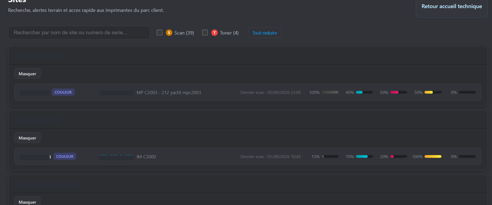

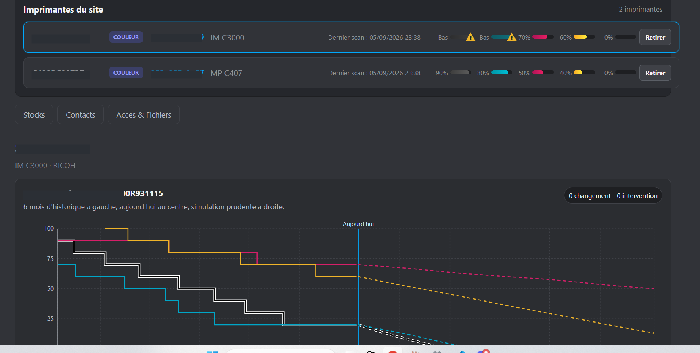

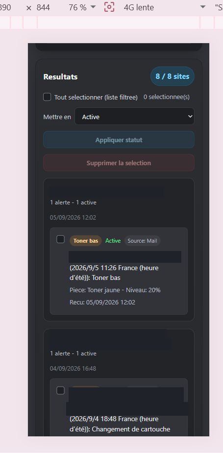

### 3. Situation initiale

L'entreprise disposait de plusieurs sources d'information, mais celles-ci n'etaient pas centralisees. Les rapports d'intervention etaient scannes, les consommables etaient suivis dans Excel, le materiel informatique etait suivi dans un autre fichier, et certaines informations importantes etaient principalement connues par les techniciens.

Cette organisation fonctionnait, mais elle presentait des limites :

- risque d'oubli d'une alerte ;
- perte de temps pour retrouver une information ;
- difficulte a connaitre rapidement le stock disponible ;
- manque de tracabilite des interventions ;
- informations client sensibles insuffisamment securisees ;
- communication parfois difficile entre technique, commercial et administratif.

### 4. Objectifs du projet

Les objectifs d'OMtek etaient :

- creer un outil de gestion de parc d'imprimantes ;
- centraliser les informations par site client ;
- suivre les imprimantes, leurs modeles et leurs consommables ;
- exploiter les alertes et rapports recus par mail ;
- faciliter la creation et le suivi des interventions ;
- securiser les donnees sensibles ;
- differencier les vues admin et technicien ;
- suivre les stocks visibles et caches ;
- reduire les delais d'intervention et de livraison ;
- ameliorer la satisfaction client ;
- preparer une evolution future vers un programme desktop.

### 5. Contraintes rencontrees

La contrainte technique principale etait l'absence d'API REST ou SOAP exploitable pour recuperer directement les donnees des sites clients. Les informations utiles etaient principalement disponibles via des rapports envoyes par mail.

D'autres contraintes ont influence le projet :

- les donnees etaient heterogenes et parfois peu structurees ;
- les rapports et alertes devaient etre interpretes avant d'etre utilisables ;
- le personnel etait prudent face au changement ;
- les informations provenant de Print Audit devaient etre conservees dans un premier temps afin de comparer l'ancien fonctionnement avec la nouvelle solution ;
- l'equipe etant reduite, il fallait eviter une rupture brutale des processus ;
- le projet devait avancer en parallele des missions d'alternance, des cours et des rendus scolaires ;
- une partie du travail de conception et de developpement etait realisee sur du temps personnel.

### 6. Acteurs impliques

Les acteurs principaux du projet sont :

- le dirigeant de l'entreprise, pour les orientations et les validations ;
- le tuteur IT, pour l'accompagnement technique et metier ;
- l'equipe technique, future utilisatrice terrain ;
- l'equipe commerciale, concernee par le suivi client ;
- l'equipe administrative, concernee par les stocks, la facturation et le suivi interne ;
- moi-meme, en charge de l'analyse, de la conception et du developpement.

### 7. Responsabilites personnelles

Mes responsabilites ont progressivement evolue. Au depart, elles etaient centrees sur l'apprentissage du metier et les interventions techniques : installation d'imprimantes, configuration des pilotes, parametrage de la numerisation, comprehension des besoins clients.

Une intervention terrain m'a particulierement aide a comprendre la realite du suivi existant. J'ai du changer un fusing, verifier l'envoi des scans en SMB pour un utilisateur dont la numerisation ne fonctionnait plus a cause d'un changement recent de mot de passe, imprimer le compteur de l'imprimante, y indiquer la reference de la piece changee, decrire le probleme de scan et relever l'etat du stock toner chez le client. De retour a l'entreprise, j'ai transmis le rapport compteur au technicien, qui l'a traite dans ses fiches personnelles pour son suivi de stock avant de le numeriser afin qu'il soit disponible dans les rapports de l'annee.

Cette situation montre pourquoi OMtek etait utile : une intervention produisait beaucoup d'informations importantes, mais celles-ci passaient encore par un circuit manuel, disperse et dependant des habitudes de chacun.

Ensuite, j'ai pris en charge une mission plus large :

- analyser les processus existants ;
- identifier les besoins non couverts ;
- concevoir la structure fonctionnelle de l'application ;
- developper le backend, le frontend et le mail-fetcher ;
- tester les fonctionnalites ;
- documenter les choix ;
- preparer les retours utilisateurs ;
- anticiper l'evolution future vers une solution desktop.

Cette progression montre une montee en autonomie : je ne me suis pas limite a executer des taches techniques, j'ai participe a la structuration d'une solution metier complete.

### 8. Methodologie adoptee

La methode de travail peut etre resumee en plusieurs etapes :

1. Observation du fonctionnement de l'entreprise.
2. Analyse des besoins et des irritants metier.
3. Recuperation et exploration des donnees disponibles.
4. Verification des solutions possibles pour collecter les informations.
5. Choix d'une premiere solution viable : le mail-fetcher.
6. Conception de l'application web avec separation backend / frontend / ingestion.
7. Creation progressive des modules : sites, imprimantes, stocks, alertes, interventions, ressources techniques.
8. Ajout de regles de securite selon les roles.
9. Amelioration de l'UX, notamment pour les techniciens.
10. Tests, corrections et preparation des retours utilisateurs.
11. Preparation d'une suite desktop pour fiabiliser l'ingestion.

Cette methode montre une logique iterative : analyser, construire, tester, corriger, puis enrichir.

### 9. Etapes de realisation verifiables dans le projet

D'apres l'historique Git et les documents du depot, la progression du projet peut etre presentee ainsi :

- audit initial de l'architecture et de la base de donnees ;
- formalisation d'un questionnaire client et des besoins metier ;
- creation d'un schema cible pour les interventions, les stocks et les droits ;
- mise en place de l'API Symfony et des entites metier ;
- creation de l'application frontend React ;
- ajout du mail-fetcher pour recuperer les donnees par mail ;
- ajout de la logique d'alertes, notamment toner et bac de recuperation ;
- ajout des interventions et de leur suivi ;
- amelioration de la gestion des stocks ;
- ajout de la distinction entre stock visible et stock cache admin-only ;
- renforcement des droits admin / technicien ;
- ameliorations graphiques et responsive ;
- preparation des tests technicien et du deploiement.

Captures a utiliser pour illustrer ces etapes :

- `assets/capture-omtek-sites-anonyme.png` : liste des sites, filtres et alertes terrain ;
- `assets/capture-omtek-detail-site-anonyme.png` : detail d'un site, niveaux toner et visualisation de consommation ;
- `assets/capture-omtek-parametres-alertes.png` : reglage et simulation des alertes ;
- `assets/capture-print-audit-anonyme.png` : ancien support Print Audit servant de point de comparaison.

Visuel a integrer : frise chronologique du projet.

### 10. Chronologie du projet

| Periode | Phase | Objectif principal | Commentaire reflexif |
| --- | --- | --- | --- |
| Septembre - octobre 2025 | Prise en main du poste et evaluation des besoins | Comprendre le metier, les interventions, les outils existants et les attentes de l'entreprise | Cette phase m'a permis de comprendre que le projet devait partir du terrain, pas seulement d'une idee technique. |
| Novembre - decembre 2025 | Recuperation des donnees et premiere conception | Explorer les donnees disponibles, tester les pistes de recuperation et commencer a structurer la solution | L'absence d'API exploitable a oriente le projet vers une solution provisoire fondee sur les mails. |
| Janvier - avril 2026 | Conception avancee et premiere version avant test | Construire le socle web, les modules principaux et la logique metier | Cette periode a transforme l'idee initiale en application utilisable. |
| Mai - juillet 2026 | Pause projet pour imperatifs scolaires | Mettre le projet en attente afin de gerer les priorites de formation | Cette pause m'a montre l'importance de documenter pour pouvoir reprendre un projet long sans perdre le fil. |
| Aout 2026 | Integration des premiers retours technicien | Ajuster l'ergonomie et les informations prioritaires | Les retours terrain ont confirme le besoin de lisibilite mobile/PWA et de priorisation des informations. |
| Septembre - octobre 2026 | Stabilisation et mise en production de test | Tester en reel, corriger legerement selon les demandes et comparer avec l'ancien systeme | Cette phase sert a rassurer l'entreprise et a mesurer les gains sans rupture brutale. |
| Novembre - decembre 2026 | Projet desktop | Preparer une solution permettant de reduire la dependance a l'ancien support et au mail-fetcher | Le desktop represente l'etape suivante de maturite : garder la valeur de l'application web tout en fiabilisant la collecte. |

Cette chronologie est importante pour le rapport, car elle montre une vraie gestion de projet : observation, conception, interruption geree, reprise, tests, stabilisation et perspective d'evolution.

### 11. Difficultes rencontrees

Plusieurs difficultes ont marque le projet.

La premiere a ete la recuperation des donnees. L'absence d'API REST ou SOAP a oblige a tester plusieurs pistes avant de retenir le mail-fetcher comme solution temporaire viable. Cette etape a ete complexe, car les donnees dependaient de mails, de formats variables et de rapports a interpreter.

La deuxieme difficulte a ete la structuration des donnees. Il fallait transformer des informations dispersees en modele coherent : sites, imprimantes, alertes, stocks, interventions, utilisateurs et droits. Cette partie demandait de comprendre le metier avant de coder.

La troisieme difficulte a ete l'organisation personnelle. Le projet etait mene en parallele de l'apprentissage du metier en entreprise, des cours de developpement web, des rendus scolaires et de la vie personnelle. Il a donc fallu apprendre a prioriser, documenter et se concentrer sur une tache a la fois.

Enfin, il a fallu tenir compte de l'acceptation du changement. Les techniciens pouvaient etre mefiants sur l'utilite reelle du logiciel. L'objectif etait donc de construire une base fonctionnelle et visuelle suffisamment claire pour obtenir des retours concrets.

Un des retours technicien concernait la visibilite des informations prioritaires : certaines donnees devaient etre placees plus haut dans les pages pour etre accessibles rapidement. Le technicien a aussi insiste sur la lisibilite mobile en PWA, ainsi que sur les reglages des alertes dans les parametres. Ces remarques ont confirme que l'ergonomie terrain etait aussi importante que les fonctionnalites.

### 12. Solutions apportees

Pour repondre aux contraintes, plusieurs solutions ont ete mises en place :

- creation d'un mail-fetcher provisoire pour recuperer les alertes et rapports ;
- creation d'une API Symfony pour centraliser les regles metier ;
- creation d'une interface web / PWA pour rendre l'outil accessible rapidement ;
- modelisation des sites, imprimantes, pieces, stocks, alertes et interventions ;
- distinction entre stock visible technicien et stock cache administrateur ;
- separation des droits admin / technicien cote API ;
- amelioration progressive de l'ergonomie ;
- ajout de parametres d'alertes permettant de tester plusieurs modes de traitement et de simuler l'effet du stock sur l'activation ou non d'une alerte ;
- preparation d'un programme desktop pour reduire la dependance au mail-fetcher.

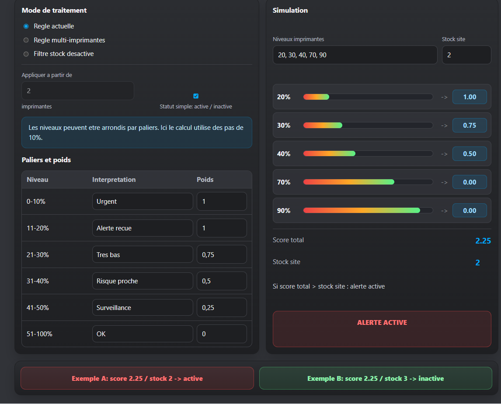

### 12.1 Valeur ajoutee du graphique de consommation

Un des avantages importants d'OMtek est la visualisation graphique de la consommation toner. Dans l'ancien fonctionnement, il fallait recouper plusieurs sources : le rapport d'intervention, le compteur imprime, l'ancien support Print Audit, les fichiers de stock et la connaissance du technicien. OMtek cherche a regrouper ces informations dans une lecture plus directe.

Le graphique permet de voir :

- l'historique des niveaux toner ;
- la position de la date du jour ;
- une simulation prudente de la consommation future ;
- les changements de cartouche ;
- les interventions associees ;
- l'impact possible sur le stock client.

L'objectif n'est pas seulement d'afficher une courbe. Le but est d'aider l'equipe a comprendre pourquoi une alerte apparait, si une cartouche a deja ete changee, si une intervention a eu lieu, et si le stock client doit etre diminue. Cette logique limite les appels de verification et permet de prioriser plus rapidement les livraisons.

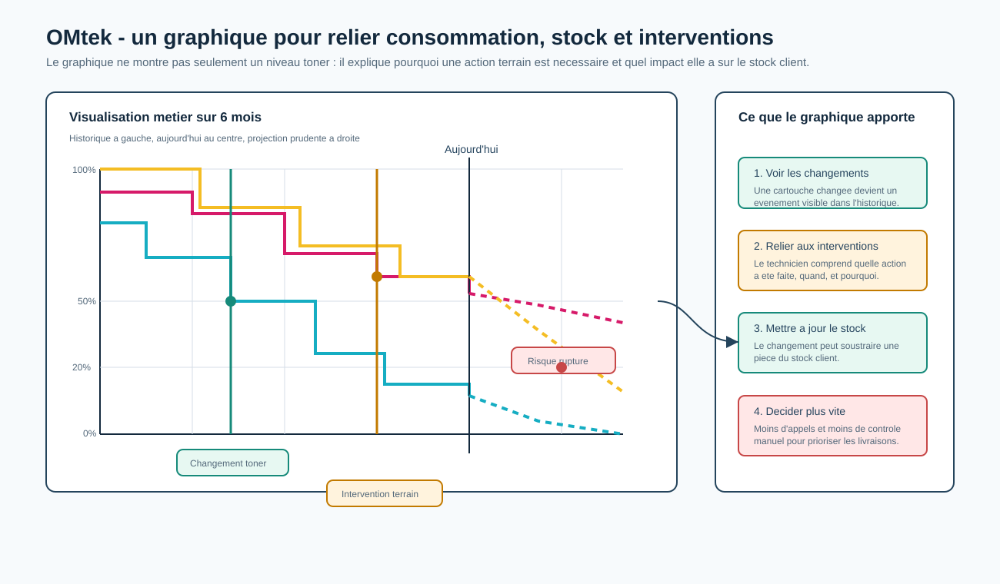

### 12.2 Flux metier : changement de cartouche et stock client

Lorsqu'une cartouche est changee, l'information peut avoir plusieurs consequences metier. Elle sert a expliquer l'evolution du niveau toner, a documenter une intervention, mais aussi a mettre a jour le stock disponible chez le client.

Le flux cible peut etre resume ainsi :

1. un changement de cartouche ou une intervention est detecte ;
2. l'information arrive par mail, rapport ou saisie dans OMtek ;
3. l'application identifie le site, la machine, la couleur et la piece concernee ;
4. une sortie peut etre appliquee au stock client ;
5. l'evenement apparait sur le graphique ;
6. l'equipe peut decider s'il faut ignorer l'alerte, livrer une piece ou creer une intervention.

Ce fonctionnement apporte de la tracabilite. Au lieu d'avoir une information isolee dans un rapport scanne, le changement devient un evenement exploitable par l'application.

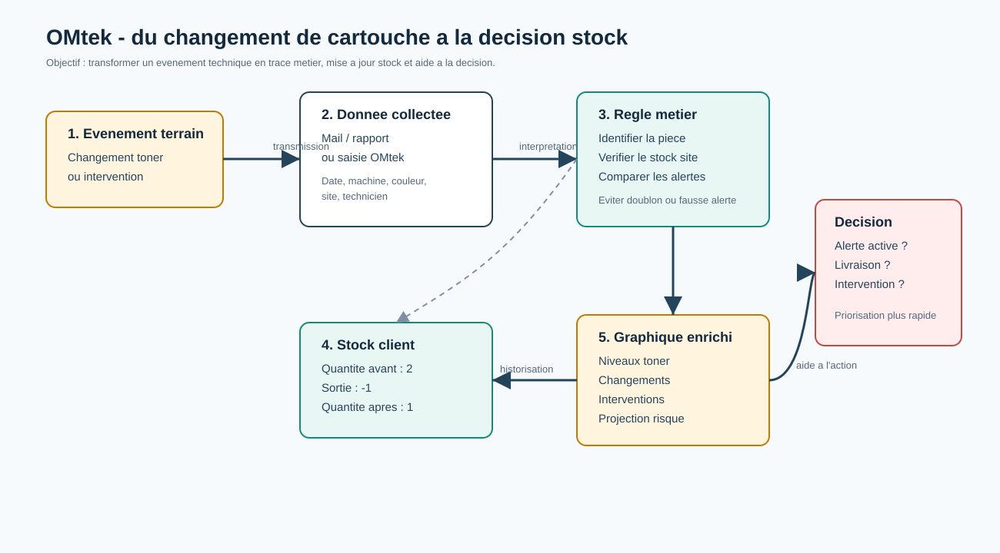

### 12.3 Cycle complet de traitement des alertes

Le traitement des alertes est un autre avantage important du projet. Dans l'ancien fonctionnement, une alerte recue devait encore etre analysee manuellement : il fallait verifier la machine, le site, le stock disponible, les changements recents et l'eventuelle repetition d'une alerte deja traitee.

OMtek structure ce traitement en plusieurs etapes :

1. reception de l'alerte par mail ;
2. recuperation et extraction par le mail-fetcher ;
3. transmission securisee a l'API ;
4. verification de la machine et du site ;
5. detection des doublons ou alertes obsoletes ;
6. application des regles metier ;
7. prise en compte des parametres d'alerte ;
8. decision : alerte active, ignoree, remplacee ou surveillee.

Cette logique permet de passer d'une alerte brute a une alerte qualifiee. Le technicien ne doit plus seulement lire une liste d'informations techniques : il peut comprendre quelles alertes demandent une action.

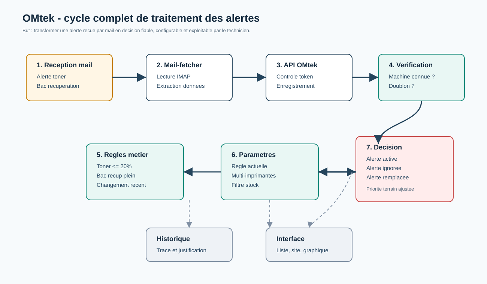

### 12.4 Role des parametres dans la decision

Les parametres d'alertes ont ete ajoutes pour tester plusieurs strategies sans modifier le code a chaque fois. Ils permettent de comparer differents modes de traitement :

- regle actuelle ;
- regle multi-imprimantes ;
- filtre stock active ou desactive ;
- paliers de criticite selon le niveau toner ;
- simulation du score compare au stock disponible.

L'interet de ces reglages est double. D'un cote, ils peuvent faire gagner du temps en ignorant certaines alertes deja couvertes par le stock ou par un changement recent. De l'autre, ils doivent etre testes avec prudence, car une alerte ignoree a tort peut creer un risque pour l'entreprise. C'est pour cette raison que la logique est actuellement comparee a l'ancien systeme avant d'etre adoptee definitivement.

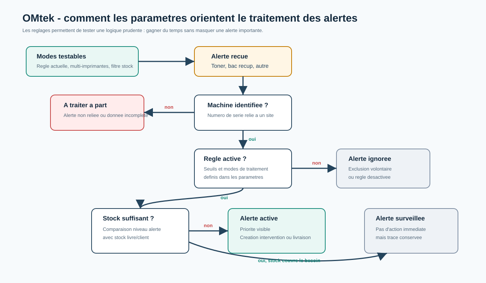

### 12.5 De l'alerte brute a l'alerte qualifiee

Le schema suivant resume la valeur metier du systeme d'alertes. OMtek ne cherche pas seulement a recevoir des alertes : il cherche a les enrichir, les verifier et les rendre utiles pour l'action.

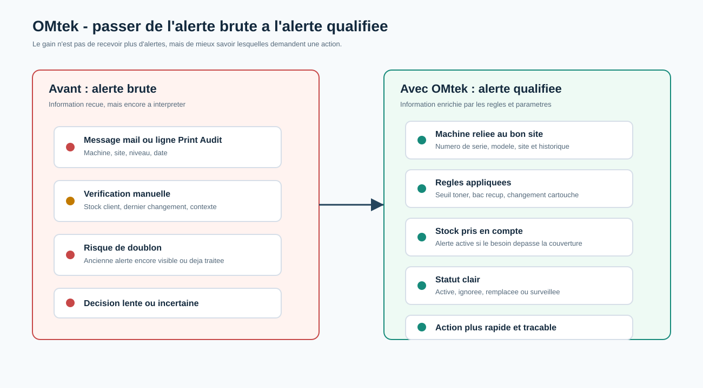

### 13. Resultats obtenus

A l'etat actuel :

- les donnees peuvent etre collectees via le mail-fetcher ;
- le support de gestion web / PWA est fonctionnel ;
- les modules principaux existent : sites, imprimantes, stocks, alertes, interventions, ressources techniques ;
- les droits admin / technicien sont renforces ;
- le stock cache est protege de la vue technicien ;
- une version est en test aupres d'un technicien depuis debut septembre 2026 ;
- le support desktop est en cours ;
- le support mobile natif reste une perspective future.

### 14. Limites actuelles

Le projet reste evolutif. Les limites principales sont :

- dependance encore presente au mail-fetcher ;
- besoin de retours terrain des techniciens et du dirigeant ;
- tests automatises a renforcer ;
- supervision et monitoring a consolider avant un usage intensif ;
- programme desktop encore en cours ;
- application mobile native non realisee a ce stade.

Ces limites ne remettent pas en cause la valeur de la V1, mais elles montrent les prochaines etapes de maturite du projet.

### 15. Outils, methodes et collaborations

Outils techniques utilises :

- Symfony 8 pour l'API ;
- Doctrine ORM pour la base de donnees et les migrations ;
- React, Vite et TypeScript pour le frontend ;
- Node.js pour le mail-fetcher ;
- IMAP pour la recuperation des mails ;
- Git et GitHub pour le versionnement ;
- fichiers Markdown pour la documentation ;
- tableaux Excel existants comme sources d'analyse ;
- rapports scannes et OCRises comme support de comprehension de l'existant.
- Print Audit comme ancien support de suivi et point de comparaison avec OMtek.

Methodes de travail :

- analyse de l'existant ;
- decoupage par modules ;
- priorisation des besoins ;
- documentation progressive ;
- verification des droits et des risques de fuite d'information ;
- approche iterative avec corrections successives ;
- preparation des retours utilisateur.

Collaborations :

- echanges avec le dirigeant et le tuteur pour valider le sens metier ;
- observation et retours de l'equipe technique ;
- prise en compte des besoins administratifs et commerciaux ;
- adaptation du vocabulaire technique pour expliquer les choix simplement.

### 16. Comparaison ancien support / nouvelle solution

L'ancien support Print Audit donnait une vision technique du parc, avec des tableaux riches en informations : noms de sites, constructeurs, adresses IP, numeros de serie, compteurs et derniers scans. Cette base etait utile, mais elle restait peu adaptee a un usage terrain rapide, notamment sur mobile.

OMtek ne cherche pas seulement a remplacer un tableau. L'objectif est de transformer ces informations en parcours metier :

- identifier vite les sites en alerte ;
- afficher les informations prioritaires en haut de page ;
- relier les alertes aux stocks et aux interventions ;
- rendre l'outil utilisable en PWA sur mobile ;
- separer les vues admin et technicien ;
- permettre une evolution future vers un programme desktop.

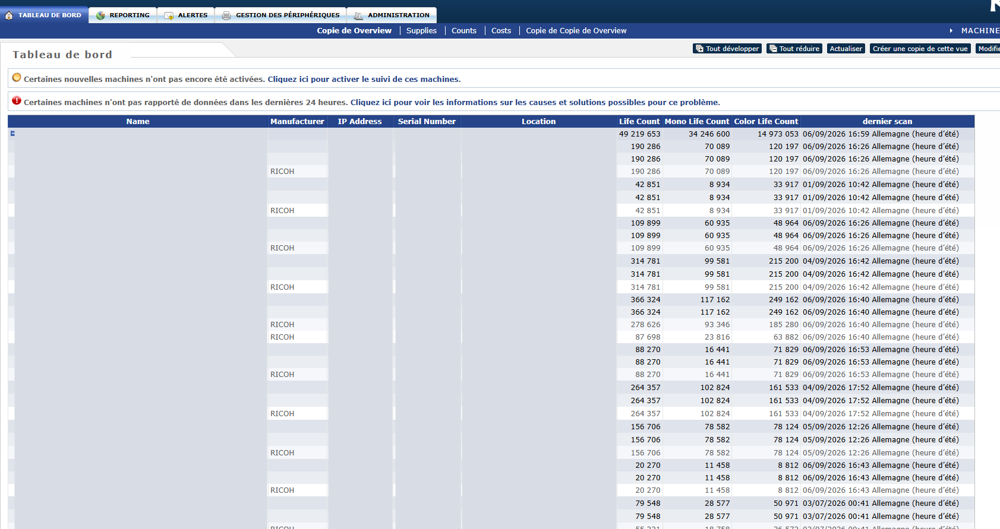

Le schema suivant resume le changement apporte par OMtek : passer d'informations dispersees a une lecture metier unique, centree sur l'action.

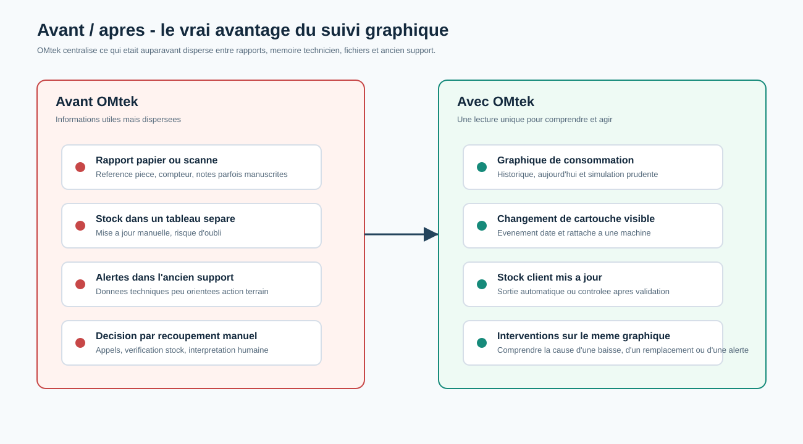

### 17. Situations concretes de soft skills

#### Autonomie

Face a l'absence d'API exploitable pour recuperer les informations des imprimantes, j'ai du chercher plusieurs solutions possibles. Apres analyse, j'ai retenu une solution provisoire basee sur la recuperation des mails. Cette decision a permis de commencer a collecter les donnees sans attendre une solution ideale.

#### Adaptation

Le personnel etait prudent face au changement. J'ai donc choisi de ne pas remplacer brutalement les processus existants. La premiere version de l'application s'appuie sur le flux mail deja en place, ce qui permet de tester l'outil sans bloquer le fonctionnement de l'entreprise.

#### Communication

Pour faire avancer le projet, j'ai du echanger avec le dirigeant, le tuteur et les techniciens afin de comprendre les besoins reels. Les choix importants, comme la separation admin / technicien ou la visibilite des stocks caches, devaient etre expliques clairement avant d'etre traduits techniquement.

Un exemple concret concerne les parametres d'alertes. Le choix de creer ces parametres vient de mon analyse : certaines alertes devaient pouvoir etre ignorees afin de gagner du temps, notamment lorsque le stock livre ou le changement recent d'un toner rendait une alerte moins prioritaire. Cette logique pouvait apporter un vrai gain de temps, mais elle representait aussi un risque si elle masquait une alerte utile. J'ai donc choisi de la tester en conditions reelles, en comparant les resultats avec l'ancien systeme de l'entreprise. Cette demarche permettait a la fois de rassurer l'equipe et de demontrer progressivement le gain apporte.

#### Rigueur

La gestion des stocks caches m'a oblige a etre rigoureux. Il ne suffisait pas de masquer une information dans l'interface : il fallait aussi s'assurer que l'API ne renvoyait jamais ces donnees a un technicien. Cette situation m'a aide a mieux comprendre la difference entre ergonomie et securite.

La logique d'alertes a egalement demande de la rigueur. Ignorer une alerte peut faire gagner du temps, mais peut aussi creer un risque si la regle est mal calibree. C'est pourquoi les parametres sont actuellement testes en conditions reelles tout en restant compares a l'ancien fonctionnement.

#### Organisation

Le projet etait mene en parallele des missions d'entreprise, des cours et de la vie personnelle. J'ai compris l'importance de documenter, de tenir une liste de taches et de prioriser les actions, meme lorsque l'on travaille seul sur un projet.

## III. Analyse reflexive et bilan de competences

### 1. Competences techniques developpees

#### Conception d'une application web complete

J'ai progresse dans la conception d'une application web reposant sur une separation claire entre backend, frontend et ingestion de donnees. Cette architecture m'a permis de mieux comprendre le role de chaque brique et la maniere dont elles communiquent.

#### Modelisation de donnees metier

La structure des donnees a ete l'une des parties les plus complexes. Il fallait modeliser des sites, des imprimantes, des pieces, des stocks, des alertes et des interventions. Cette experience m'a fait progresser dans la conception de bases de donnees et dans la traduction d'un besoin metier en entites techniques.

#### Securisation des acces

La distinction admin / technicien m'a permis de travailler sur les droits, les restrictions d'acces et les risques de fuite d'information. J'ai compris qu'une regle importante doit etre appliquee cote API, pas uniquement dans l'interface.

#### Recuperation et traitement de donnees

Le mail-fetcher m'a permis de travailler sur la recuperation de mails, leur analyse et leur transformation en donnees exploitables. Cette partie m'a confronte a des donnees moins propres que dans un exercice scolaire.

#### UX et responsive

L'adaptation de l'interface aux techniciens m'a fait progresser dans la conception d'une experience plus simple, plus lisible et plus orientee terrain.

### 2. Competences transversales developpees

#### Autonomie

J'ai du avancer sans cahier des charges complet, analyser les besoins, chercher des solutions et proposer des choix techniques. Cette autonomie s'est construite progressivement, avec des validations regulieres lorsque les decisions avaient un impact metier.

#### Adaptation

J'ai adapte la solution aux contraintes de l'entreprise : absence d'API, donnees dispersees, equipe reduite, prudence face au changement. Le choix d'une transition progressive montre cette adaptation.

#### Communication professionnelle

J'ai appris a reformuler des problemes techniques en enjeux metier. Par exemple, expliquer pourquoi un stock cache devait etre protege cote API demandait de parler securite et processus, pas seulement code.

#### Organisation et gestion du temps

Le projet m'a oblige a mieux organiser mon travail. J'ai compris l'importance d'une documentation suivie et d'une todo list pour ne pas perdre le fil, surtout sur un projet long repris a plusieurs moments.

#### Resolution de probleme

La recherche d'une solution pour recuperer les donnees sans API officielle a ete un bon exemple de resolution de probleme. Il a fallu tester, eliminer des pistes, accepter une solution temporaire, puis preparer une evolution plus robuste.

### 3. Recul critique

#### Ce qui a bien fonctionne

L'approche progressive a bien fonctionne. En conservant le flux mail existant, le projet a pu avancer sans imposer un changement brutal a l'entreprise. L'application web permet deja de presenter une base fonctionnelle et de recueillir des retours.

La documentation et la conception ont aussi ete importantes. Elles m'ont aide a structurer le projet et a eviter de me perdre dans les fonctionnalites.

Le fait de comparer OMtek avec l'ancien support Print Audit a aussi facilite l'acceptation. L'entreprise pouvait continuer a s'appuyer sur ses habitudes tout en observant ce que la nouvelle application apportait : meilleure lisibilite, centralisation, acces mobile et suivi plus structure.

#### Ce qui a ete difficile

Il a ete difficile de liberer du temps et de garder une vision claire du projet. Je devais a la fois apprendre le metier, suivre les cours, realiser les rendus scolaires, avancer sur le developpement et gerer ma vie personnelle.

Techniquement, la recuperation des donnees a ete l'une des parties les plus complexes. L'absence d'API directe a oblige a passer par le mail-fetcher, avec les limites que cela implique.

Il a aussi ete difficile de structurer ma pensee sur un projet long, surtout lorsque je devais l'interrompre puis le reprendre plus tard.

#### Ce que j'aurais pu anticiper

J'aurais pu anticiper davantage :

- le temps necessaire a la modelisation des donnees ;
- la complexite de la recuperation par mail ;
- l'importance de documenter chaque decision des le debut ;
- le besoin de prioriser plus strictement ;
- la necessite d'impliquer les utilisateurs finaux plus tot pour valider l'ergonomie.

#### Erreur ou limite qui m'a fait progresser

Une limite importante a ete la dispersion. En travaillant sur plusieurs idees ou plusieurs parties du projet en meme temps, j'ai parfois perdu du temps et de la concentration. Avec le recul, j'ai compris qu'il est plus efficace de finir une etape, la tester et la documenter avant de passer a la suivante.

Une autre limite a ete la dependance initiale aux donnees recuperees par mail. Cette contrainte m'a fait comprendre l'importance de concevoir une architecture evolutive, capable de fonctionner avec une solution provisoire tout en preparant une solution plus robuste.

#### Decisions que je referais autrement

Avec le recul, je me disperserais moins. Je definirais plus tot un perimetre V1 tres clair, avec une liste de fonctionnalites indispensables et une liste de fonctionnalites a garder pour plus tard.

Je documenterais aussi davantage les choix au moment ou ils sont pris, pour faciliter la reprise du projet apres une pause.

#### Impact sur l'entreprise

Le projet a un impact positif potentiel pour l'entreprise. Depuis debut septembre 2026, une version fonctionnelle est en cours de test aupres d'un technicien. Ces retours doivent permettre de valider l'experience utilisateur et d'identifier les ameliorations a apporter.

A terme, OMtek peut faire gagner du temps, limiter les oublis, ameliorer le suivi des stocks et renforcer la communication entre les services.

L'impact attendu est particulierement visible sur le traitement des alertes : si les regles de parametrage sont validees, l'equipe pourra se concentrer sur les alertes vraiment utiles, reduire les controles manuels et mieux anticiper les livraisons de consommables.

### 4. Bilan personnel

#### Ressenti global

J'ai apprecie travailler sur ce projet, car il m'a oblige a chercher des solutions adaptees a une situation reelle. OMtek n'est pas seulement un exercice technique : c'est un projet lie a des contraintes d'entreprise, a des utilisateurs et a des processus existants.

Ce projet m'a aussi montre l'importance de la documentation et de la conception. Avant, j'avais tendance a vouloir avancer rapidement dans le code. Avec cette experience, j'ai compris qu'un projet long demande une vision, un suivi et des priorites claires.

#### Evolution entre le debut et la fin

Entre le debut de l'alternance et l'etat actuel du projet, j'ai progresse dans ma comprehension du metier de concepteur developpeur web. Les notions vues en cours m'ont ete utiles pour structurer l'application, comprendre les donnees, organiser les fonctionnalites et securiser les acces.

J'ai egalement progresse dans la gestion de projet, la communication avec les utilisateurs et la prise d'initiative.

#### Confiance gagnee

Ce projet m'a donne confiance dans ma capacite a mener une solution de bout en bout : analyser un besoin, concevoir une architecture, developper une application, corriger les problemes et preparer les evolutions futures.

#### Competences a renforcer

Les competences a renforcer sont :

- l'utilisation d'outils UML professionnels ;
- la documentation continue ;
- la priorisation stricte ;
- la capacite a ne pas me disperser ;
- les tests automatises ;
- la preparation d'une mise en production robuste.

#### Impact sur mon projet professionnel

Ce projet confirme mon interet pour le developpement d'applications metier. J'ai compris que ce qui m'interesse n'est pas seulement d'ecrire du code, mais de comprendre un probleme concret, de concevoir une solution utile et de l'adapter aux utilisateurs.

OMtek m'a aussi donne envie de progresser sur la conception logicielle, l'architecture, la securite des donnees et l'experience utilisateur. Il renforce donc mon projet professionnel autour du developpement d'applications web et metier, avec une attention particuliere a la qualite, a la maintenabilite et aux usages reels.

## IV. Conclusion et perspectives

### 1. Synthese de l'experience

Cette experience m'a permis de decouvrir le fonctionnement d'une PME de bureautique et d'informatique, tout en menant un projet de developpement concret. A partir d'un besoin de suivi des imprimantes, des consommables et des interventions, j'ai participe a la conception d'un outil metier complet : OMtek.

Le projet est parti d'un existant disperse et parfois fragile pour aller vers une solution centralisee, structuree et securisee.

### 2. Apports principaux

Les apports principaux sont :

- meilleure comprehension du metier de l'entreprise ;
- progression en conception et developpement web ;
- experience concrete de modelisation de donnees ;
- prise en compte des roles et de la securite ;
- apprentissage de la gestion de projet ;
- meilleure capacite a communiquer avec des utilisateurs ;
- prise de recul sur les limites d'une solution technique.

### 3. Perspectives professionnelles

Les perspectives du projet OMtek sont :

- finaliser les tests terrain avec les techniciens ;
- corriger l'ergonomie selon les retours ;
- renforcer les tests automatises ;
- consolider le deploiement ;
- poursuivre le programme desktop pour reduire la dependance au mail-fetcher ;
- envisager une application mobile native si le besoin terrain le justifie.

### 4. Lien avec la formation

Ce projet mobilise plusieurs competences liees a la formation :

- analyse du besoin ;
- conception d'une base de donnees ;
- developpement backend ;
- developpement frontend ;
- securisation d'une application ;
- gestion de projet ;
- documentation ;
- test et amelioration continue.

### 5. Objectifs pour la prochaine experience

Pour la suite, mes objectifs sont :

- mieux cadrer le perimetre d'une V1 ;
- documenter mes choix plus regulierement ;
- renforcer mes competences en architecture logicielle ;
- progresser sur les tests automatises ;
- impliquer plus tot les utilisateurs finaux ;
- continuer a developper des applications utiles et adaptees a des besoins reels.

## Annexes conseillees

Les annexes ne comptent pas dans les 30 pages minimum, mais elles peuvent renforcer la qualite du livrable.

Annexes a prevoir :

- schema UML de l'architecture d'evolution ;
- schema UML du domaine metier ;
- diagramme de sequence mail-fetcher ;
- schema explicatif du graphique de consommation, changements de cartouche et interventions ;
- schema du flux changement de cartouche vers soustraction du stock client ;
- schema avant / apres sur le suivi des consommables ;
- schema du cycle complet de traitement des alertes ;
- schema de decision des parametres d'alertes ;
- schema de comparaison alerte brute / alerte qualifiee ;
- frise chronologique du projet ;
- captures anonymisees de l'application web : sites, detail site, parametres d'alertes ;
- capture responsive mobile ou PWA : `assets/capture-omtek-mobile-pwa-alertes-anonyme.png` ;
- capture de l'ancien support Print Audit pour expliquer le contexte de transition : `assets/capture-print-audit-dashboard-anonyme.png` ;
- extrait de documentation fonctionnelle ;
- tableau comparatif avant / apres OMtek ;
- glossaire technique.

## Repartition indicative pour 30 pages

| Partie | Pages conseillees |
| --- | ---: |
| Page de garde, remerciements, sommaire | 3 |
| Introduction et contexte | 5 |
| Missions et projet OMtek | 11 |
| Analyse reflexive et bilan de competences | 8 |
| Conclusion et perspectives | 3 |

Total indicatif : 30 pages hors annexes.

## Elements qui restent a completer par toi

Ces points ne peuvent pas etre inventes sans risque :

- la taille exacte de l'entreprise si tu veux la chiffrer officiellement ;
- verifier une derniere fois les captures anonymisees avant rendu officiel ;
- remplacer les accents manquants dans la version finale si tu exportes vers Word/PDF.
