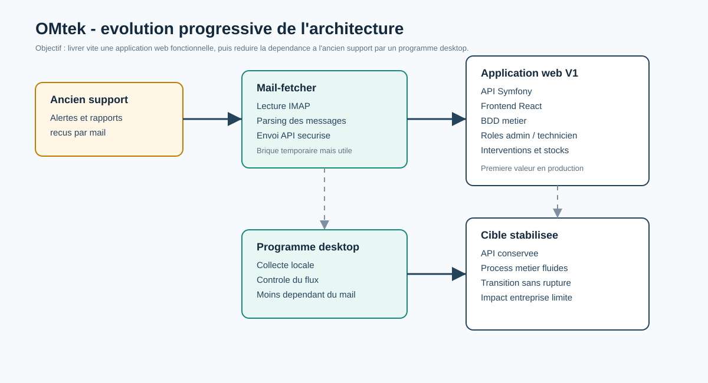
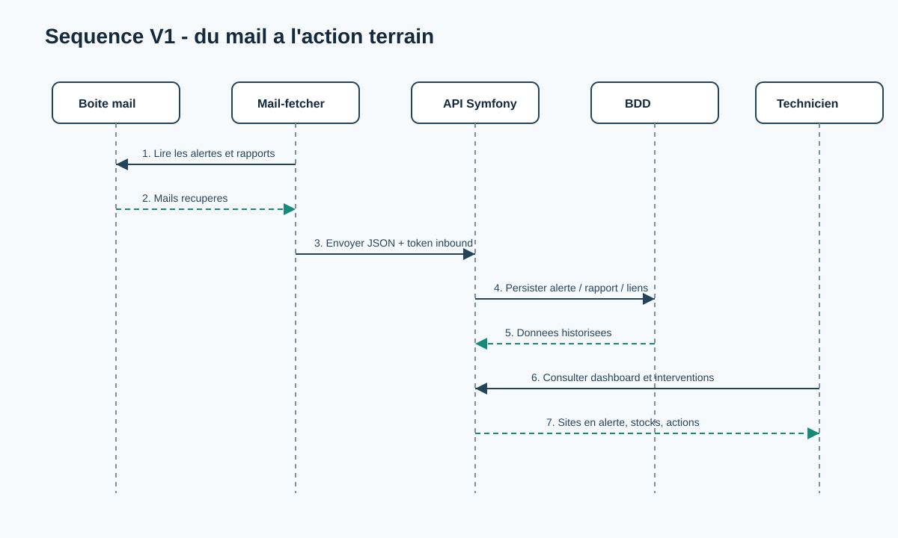
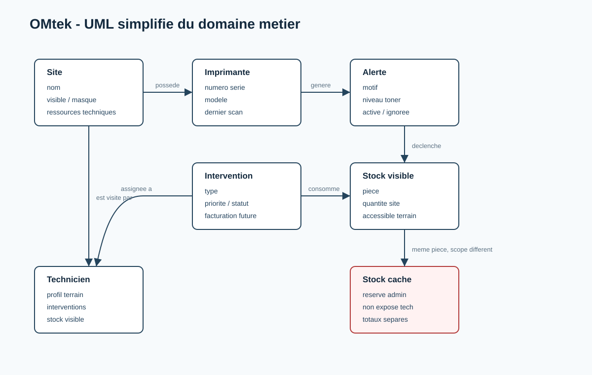

# Construction pas a pas du projet OMtek

> Ce document sert de base pour le rapport d'experience professionnelle B3. Il reconstruit le cheminement du projet a partir des traces disponibles dans le depot, des documents existants et de la demande actuelle. Les anciennes conversations completes ne sont pas accessibles directement ici : les questions en fin de document servent donc a recuperer ton raisonnement personnel, tes doutes et tes decisions.

## 1. Intention du projet

OMtek a ete pense comme une application de supervision d'un parc d'imprimantes client. L'objectif n'etait pas seulement de creer une interface de gestion, mais de transformer un fonctionnement fragile, base sur des alertes mail et des rapports de scan, en outil metier exploitable par deux profils :

- l'administrateur, qui supervise, parametre, gere les donnees sensibles et garde la vision complete ;
- le technicien, qui agit sur le terrain, priorise ses interventions et doit acceder rapidement aux informations utiles sans etre noye dans des donnees administratives.

La logique de depart etait pragmatique : creer d'abord une application web fonctionnelle capable de s'appuyer sur le `mail-fetcher`, puis preparer une evolution vers un programme desktop pour reduire progressivement la dependance a l'ancien support. Cette approche permet de ne pas casser les habitudes de l'entreprise d'un seul coup et de faire evoluer les processus de maniere fluide.

## 2. Probleme initial

Le besoin de l'entreprise part d'une situation concrete : les informations importantes arrivent par mails ou par rapports de scan, mais elles ne sont pas directement transformees en actions terrain. Sans outil centralise, plusieurs risques apparaissent :

- une alerte toner ou bac de recuperation peut etre oubliee ;
- un site qui ne remonte plus de scan peut passer inapercu ;
- le stock disponible sur site peut etre mal connu ;
- les interventions peuvent manquer de suivi ;
- les informations sensibles ne sont pas toujours separees selon les roles.

La question de depart pouvait donc se formuler ainsi :

> Comment transformer des signaux techniques disperses en decisions simples pour un technicien, tout en gardant une supervision complete et securisee pour l'administrateur ?

## 3. Choix d'une strategie progressive

Le projet n'a pas ete pense comme une rupture brutale. La strategie retenue suit une logique de transition :

1. conserver le flux existant des mails pour ne pas perturber l'entreprise ;
2. creer un `mail-fetcher` capable de lire et parser ces mails ;
3. envoyer les donnees utiles vers une API Symfony ;
4. stocker les alertes, rapports, sites, imprimantes, pieces, stocks et interventions en base ;
5. proposer une interface web React utilisable par l'admin et le technicien ;
6. durcir progressivement les regles metier : roles, stocks caches, sites masques, alertes actives ;
7. preparer ensuite un programme desktop pour remplacer ou completer l'ancien support.

Cette methode montre une competence importante : l'adaptation. Au lieu d'imposer directement un nouvel outil a l'entreprise, le projet respecte l'existant et construit une couche fonctionnelle par-dessus.

## 4. Architecture fonctionnelle retenue

La V1 repose sur trois blocs principaux :

- `mail-fetcher/` : programme Node.js responsable de la recuperation et du traitement des mails ;
- `api/` : API Symfony avec Doctrine, qui porte les regles metier et la securite ;
- `frontend/` : application React/Vite/TypeScript, orientee usage admin et technicien.

Le choix est coherent avec une application metier interne :

- Symfony apporte une structure robuste pour les entites, les migrations, les roles et les endpoints ;
- React permet de faire evoluer rapidement les vues ;
- Node.js est adapte pour l'ingestion mail ;
- la separation API/front/mail-fetcher limite les responsabilites de chaque partie.

## 5. Logique metier principale

Le domaine OMtek se construit autour de quelques objets importants :

- un `Site`, qui regroupe les machines et les ressources techniques ;
- une `Imprimante`, rattachee a un site et a un modele ;
- une `Alerte`, issue principalement des mails ;
- un `RapportImprimante`, qui historise les donnees de scan ;
- une `Piece`, compatible avec des modeles d'imprimantes ;
- un `Stock`, visible ou cache selon la portee ;
- une `Intervention`, qui transforme un probleme detecte en action terrain ;
- un `Utilisateur`, admin ou technicien.

Le point important est que la technique reste au service du metier. Par exemple, une alerte toner ne doit pas seulement etre affichee : elle doit aider a decider s'il faut livrer une piece, creer une intervention ou ignorer une alerte devenue obsolete.

## 6. Etape 1 - Comprendre le besoin terrain

La premiere reflexion a consiste a separer deux visions :

- la vision administrateur : complete, parametrable, avec acces aux donnees sensibles ;
- la vision technicien : rapide, mobile-first, centree sur l'action.

Cette separation a evite de construire une application unique trop lourde pour tout le monde. Elle repond aussi a un enjeu de securite : certaines informations, comme les stocks caches ou les donnees comptables, ne doivent pas etre exposees au technicien.

Question de recul a integrer dans le rapport :

> A quel moment ai-je compris que le technicien n'avait pas besoin de "tout voir", mais de voir vite les bonnes informations ?

## 7. Etape 2 - Auditer l'existant

Les documents d'audit montrent que le projet avait deja une base exploitable : utilisateurs, sites, imprimantes, modeles, pieces, stocks, alertes et rapports. Mais plusieurs limites etaient identifiees :

- absence initiale d'un vrai workflow d'intervention ;
- pages front trop denses et trop orientees tableau ;
- separation admin/technicien insuffisamment forte ;
- absence d'historique metier complet sur les mouvements de stock ;
- calculs de supervision parfois trop portes par le frontend.

Cette phase est importante pour l'analyse reflexive : elle montre que le travail n'a pas commence par coder au hasard, mais par identifier les ecarts entre l'existant et le besoin metier.

## 8. Etape 3 - Construire le socle technique

Le socle technique s'est organise autour de :

- l'API Symfony ;
- la base de donnees Doctrine ;
- le frontend React ;
- l'ingestion mail en Node.js.

Le `mail-fetcher` utilise notamment une connexion IMAP pour recuperer les mails, analyser leur contenu et transmettre les alertes a l'API. Cette dependance n'est pas parfaite, mais elle a permis de livrer rapidement une premiere valeur.

Analyse critique :

- avantage : reutiliser les mails existants evite une rupture de processus ;
- limite : le fonctionnement reste dependant de la qualite des mails, du parsing et de la disponibilite de la boite ;
- perspective : le programme desktop permettrait de reprendre le controle sur la collecte et de fiabiliser la chaine.

## 9. Etape 4 - Transformer les alertes en logique actionnable

Une evolution forte du projet concerne la logique des alertes. La signalisation `T` d'un site repose sur des alertes mail actives :

- toner inferieur a 20 % ;
- bac de recuperation presque plein ou plein ;
- possibilite de desactiver une alerte ;
- desactivation automatique de certaines alertes devenues obsoletes.

Cette partie montre une progression importante : passer d'une donnee recue a une donnee interpretee. Le projet ne stocke pas seulement les mails ; il applique des regles pour aider a prioriser.

Situation concrete possible pour illustrer l'autonomie :

> En constatant que certaines alertes pouvaient rester visibles alors qu'elles n'etaient plus pertinentes, j'ai du analyser les cas metier, comprendre les motifs de mails, puis faire evoluer la logique pour distinguer les alertes actives, ignorees ou remplacees par une information plus recente.

## 10. Etape 5 - Ajouter les interventions

L'entite `Intervention` donne une dimension operationnelle au projet. Une alerte ou un besoin terrain peut etre transforme en action suivie :

- type d'intervention : livraison toner, depannage, telemaintenance ;
- source : manuel, alerte mail, absence scan, supervision ;
- priorite ;
- statut ;
- notes technicien ;
- informations preparees pour la facturation future ;
- archivage.

Cette evolution relie directement la supervision au travail terrain. C'est aussi un bon exemple de gestion de projet : il ne suffisait pas d'afficher les problemes, il fallait permettre leur traitement.

## 11. Etape 6 - Gerer les stocks visibles et caches

Le stock a ete pense avec une regle importante :

- `TECH_VISIBLE` : stock visible et utilisable par le technicien ;
- `ADMIN_ONLY` : stock cache, reserve a l'administrateur.

Cette decision evite une fuite d'information et permet de garder une reserve admin sans perturber l'usage terrain. La regle doit etre appliquee cote API, et pas seulement dans le frontend.

Analyse critique :

> Ce choix m'a force a comprendre qu'une regle d'affichage n'est pas une vraie regle de securite. Meme si le frontend masque une information, elle peut fuir si l'API la renvoie. La securite devait donc etre portee par le backend.

## 12. Etape 7 - Adapter l'interface aux usages mobiles

Le projet a progressivement quitte une logique de tableau desktop pour aller vers une logique mobile-first. Cette evolution est importante pour un technicien :

- affichage plus rapide des sites en alerte ;
- priorisation des actions ;
- meilleure lisibilite des niveaux toner ;
- pages moins lourdes ;
- navigation adaptee au terrain.

Situation concrete de soft skill :

> J'ai du me mettre a la place d'un utilisateur terrain : il ne consulte pas l'application dans les memes conditions qu'un administrateur au bureau. Cette prise de recul m'a pousse a simplifier les ecrans et a prioriser les informations utiles a l'action.

## 13. Etape 8 - Durcir les roles et les acces

Le projet a renforce la separation entre admin et technicien :

- le technicien masque les site qui ne doive plus etre controler a cause de litige ou d'arret de contrat en attandant les directive du superieur ;
- le technicien ne voit pas les stocks caches ;
- le technicien n'a pas acces a la partie comptable ;
- les restrictions sont appliquees cote API ;
- les actions sensibles doivent rester tracables.

Cette partie peut illustrer la rigueur professionnelle. Elle montre que l'application n'est pas seulement fonctionnelle, mais pensee pour un usage reel en entreprise.

## 14. Etape 9 - Preparer le deploiement et la recette

Les documents du projet indiquent une preparation vers OVH pour tester l'application en conditions reelles. Cette etape marque le passage d'un projet de developpement a un produit exploitable.

Points importants pour le rapport :

- parler de la mise en ligne comme d'un objectif de validation ;
- expliquer les risques : sauvegarde, configuration, securite, donnees reelles ;
- montrer que les tests technicien permettent de verifier les choix faits en amont.

## 15. Etape 10 - Preparer la suite desktop

La suite logique est la creation d'un programme desktop pour ne plus dependre uniquement de l'ancien support mail. L'objectif n'est pas de supprimer brutalement le `mail-fetcher`, mais de faire une transition controlee :

- garder l'application web comme centre metier ;
- remplacer progressivement la source d'ingestion ;
- limiter l'impact sur l'entreprise ;
- conserver les habitudes utiles pendant la transition ;
- fiabiliser la collecte a long terme.

Cette approche montre une capacite de recul : le meilleur choix technique n'est pas toujours de tout refaire, mais de faire evoluer le systeme sans bloquer le travail quotidien.

## 16. Analyse des competences developpees

### Autonomie

L'autonomie apparait dans la capacite a analyser les alertes, comprendre la logique metier et proposer des evolutions sans attendre une specification parfaite.

Exemple a personnaliser :

> Lorsque j'ai rencontre des incoherences dans les alertes toner ou les machines anciennes, j'ai du identifier la cause, verifier les donnees, puis corriger la logique pour que l'affichage corresponde mieux a la realite terrain.

### Adaptation

Le projet montre une adaptation aux contraintes de l'entreprise : le flux mail existant a ete conserve dans un premier temps pour eviter une rupture.

Exemple a personnaliser :

> Plutot que de remplacer directement le processus existant, j'ai choisi une solution intermediaire qui exploite les mails actuels tout en preparant une architecture plus fiable pour la suite.

### Communication professionnelle

La communication apparait dans la validation progressive des choix metier : roles, droits, stocks caches, parcours technicien, intervention.

Exemple a personnaliser :

> Chaque fois qu'une regle pouvait impacter l'entreprise, comme la visibilite des stocks caches ou les droits du technicien, j'ai du formuler le besoin clairement avant de le traduire techniquement.

### Esprit critique

Le projet contient plusieurs limites identifiees :

- dependance au mail-fetcher ;
- besoin de tests automatises plus large ;
- risque de pages front trop complexes ;
- besoin de supervision et de monitoring en production ;
- necessite de verifier les usages avec de vrais techniciens.

Cette lucidite est importante pour le rapport : elle montre que tu ne presentes pas seulement le projet comme une reussite, mais comme une progression.

## 17. Questions pertinentes pour completer ton recit personnel

Reponds a ces questions avec des exemples concrets. Meme des reponses courtes suffisent, je pourrai ensuite les integrer dans le rapport.

### Contexte entreprise

1. Quel est le nom de l'entreprise ou comment veux-tu la presenter si elle doit rester anonymisee ?
entreprise a taille humaine avec un bon decoupage des tache mais necessitant une entraide constante entre les differents services pour le bon fonctionnement de l'entreprise .
2. Quelle etait ta periode exacte de stage/alternance ?
09/25 au 11/26
3. Quel etait ton role officiel ?
technicien it , gestion des conditionnement des nouveau serveur d'impression , le la telemaintenance et aide a l'instalation sur site
4. Qui utilisait ou devait utiliser OMtek : toi, un responsable, des techniciens, un service administratif ?
tous doive l'utiliser pour une bonne circulation des information
5. Quel probleme existait avant OMtek dans la gestion des imprimantes ?
plusieur support a consulter pour une meme tache se qui revener a un vrait travaille d'enquete pour regrouper les information

### Naissance du projet

6. Quelle a ete la premiere idee du projet ?
regrouper les donnée dans un meme logiciel
7. Quelle question t'es-tu posee au debut : "comment lire les mails", "comment afficher les alertes", "comment aider le technicien", autre ?
comment faire gagner du temps et ameliorer l'efficasité . et coment recuperer les données pour mieux les restituer
8. Qu'est-ce qui etait le plus flou au depart ?
la logique metier de l'entreprise et leur contraite afin de partir sur les meilleur base a etait compliquer car il y avait beaucoup a apprendre avant meme de pouvoir coder
9. Quelle contrainte t'a oblige a garder le mail-fetcher dans une premiere version ?
le fait de ne pas pouvoir les recuperer via une api restfull et le fait de devoir mettre a jour chaque site client avec la solution desktop serais trop long a faire sans solution intermediaire
10. A quel moment l'idee du futur programme desktop est-elle apparue ?
quand j'ai appris a mieux connaitre a la foix le metier dans l'enteprise et aussi grace au cours . il me manquer les notion pour pouvoir interoger les imprimante en snmp et aussi les cours en desktop qui sont arriver en fin de cursus scolaire

### Decisions techniques

11. Pourquoi avoir choisi une application web d'abord ?
meilleur solution pour etre accessible partout 
12. Pourquoi Symfony pour l'API ?
c la techno ou je suis le plus a laise et qui correspond aussi au besoin
13. Pourquoi React pour le frontend ?
un meilleur comportement pour ux et plus fluide meme si c pas mon poind fort le rendue en vaut le coup
14. Pourquoi Node.js pour le mail-fetcher ?
techno proposer par IA car je me sentais pas de faire cette partie seul dans les temps impartie donc j'ais utiliser l'outil ia pour assurer une bonne avancer sur cette partie
15. Quelle a ete la partie la plus difficile techniquement ?
le mail fetcher car bien que fait par IA il a fallu faire de nombreus ajustement et il a fallu aussi le faire tourner sur une vm car mon hebergement mutualiser ne permet pas de le faire dessus
16. Quelle erreur ou impasse t'a fait changer de methode ?
le recuperation de données que je penser etre plus simple et qui m'as mis en difficulter . les filtre pour les alert qui ont cree plusieur probleme fonctionnel et qui ont ete dure a implementer 

### Logique metier

17. Comment as-tu compris la logique toner/bac de recuperation ?
dans se metier il y a les consommable , les piece detacher et les imprimante , donc il etait imperatif de lier les piece et consomable a des modele qui sont lier a des imprimante(ref) . et donc la majorité des action ne concerne que des consommable qui sont frequant et imperatif et dans un deuxieme temps les depannage qui ne concerne que des piece detachée le tout se basant sur l'experience du terrain vecu avec les technicien
18. Comment as-tu decide qu'une alerte devenait actionnable ?
les alert sur l'ancien support revyer une alert a chaque scan reseaux donc toute les 3 h , donc beaucoup de redondance , une personne qui les suit tout le temp si retrouve mais des qu'il demande de l'aide il n'i a pas d'historique et la personne a tendance de rappeler chaque client en alert pour etre sur qu'il est de l'encre mais si on la deja appeler ,in se retrouve a le deranger et sa montrer un probleme au pret du client donc il fallais remedier a sa pour plus de professionalisme et aussi pour gagner du temp et rendre les tache abordable pour tous
19. Comment as-tu gere les anciennes machines ou les doublons ?
les ancienne machine quand elle sont remplacer par les nouvelle sont toujour mise sur la meme ip que l'ancienne donc une detection automatique a ete cree et un retrait manuel pour les exception en garantissent de pouvoir revenir en arriere en cas d'erreur sans perdre les donnée
20. Pourquoi fallait-il distinguer stock visible et stock cache ?
le gerant garde un stock a part qu'il controle lui meme car il a deja eu des vole de la part d'un technicien et suivre se stock et compliquer pour lui 
21. Quelles informations un technicien ne devait absolument pas voir ?
les stock caché et la partie comptabilité

### UX et utilisateurs

22. Quelle difference as-tu observee entre un besoin admin et un besoin technicien ?
ormit le stock cacher et la partie comptabilité le reste peut etre vue , on pourra imaginer dans le future de nombreuse partie a implementer comme les demande de congé afin de isualiser pour le technicien les disponibilité des congé sans voir qui les a pris et le gerant lui pourra visialiser l'ensemble des donnée et se decharger des conflit lié au dispo 
23. Pourquoi le mobile-first est-il important dans ce projet ?
car les technicien doive pouvoir agir sur les donnees cher les client quand il livre , depanne ou controle les stock client
24. Quel ecran a demande le plus de reflexion ?
le mobile en taille S22 a ete le plus dur (small device) car les tableau de piece ou les nombrese donnees technique sont dure a afficher 
25. As-tu eu des retours utilisateur ou des tests terrain ?
oui est elle concerne plus l'experience sur mobile et les principe de fonctionnement
26. Quelle modification UX a le plus ameliore l'utilisation ?
un tri stricte des donnees essentiel a ete mis en place avec le technicien pour etre mieux adapter au mobile et les graphique vue avec le gerant qui apporte une grosse pluvalue

### Gestion de projet

27. Comment as-tu priorise les fonctionnalites ?
d'abort la securité car les données concerne des client dont des notaire , ensuite les fonctionnalité metier pour la validité des données et enssuite les fonctionnaliser metier trie des alert gestion des stock 
28. Comment as-tu decide quoi faire maintenant et quoi garder pour plus tard ?
j'ai prioretiser en suivant cette trame => collecte des données , centralisation , stokage et visualisation des donnees , puis les priorité metier point par point => simplifier les alert en implementant les stock client => gestion des stocke entreprise => gestion des site 
29. As-tu documente les choix au fur et a mesure ?
de facon superficiel en listant les fonctionnalitée a cree est les chose a implementer afin de bien suivre le fils des action et quelque visuel pour les compte rendue avec reunion et petit support visuel a l'intention de l'equipe pour avoir des retour afin de bien suivre les desire et objetife du client
30. Comment as-tu gere les moments ou la demande changeait ?
chaque partie int ete faite de facon a pouvoir revenir sur une version anterieur du git si les changement ete trop important et des petit correctif pour les aspet visuel 
31. Quel compromis as-tu accepte pour livrer une V1 fonctionnelle ?
aucun pour le moment hormis du temp personnel mais sa viendr surement . 

### Soft skills

32. Donne une situation ou tu as ete autonome.
sur le fait de cree les filtre pour les alert il a fallu que j'imagine de traiter les niveaux de toner par seuil de criticiter car quand un site client a qu'une imprimante sont seuil et tres different d'un site qui possede 6 imprimante qui consomme la meme cartouche donc dans se cas de figure 1 imprimante avec 1 toner en stock iraus tres bien mais 6 imprimante qui sont toute a 20% d'encre et qui ont 2 toner de rechange aura un serieur probleme d'ou une reflexion pousser sur le sujet
33. Donne une situation ou tu as du t'adapter.
sur les habitude du technicien qui a l'habitude de nommé les toner ou autre piece detaché par des ancienne reference qui ne sont plus presente donc par exemple quand il parle de toner 3003 alors que c sur les ref du 3503 ,il as fallus adaptr le logicien afin qu'il affiche la ref reel et les correspondance 
34. Donne une situation ou tu as du expliquer un choix technique simplement.
le choix des alert a ete dure a expliquer de facon simple au gerant qui ne realiser pas a quel point c'etait dure a suivre pour une personne qui n'est pas tout le temp impliquer et la necessité de simplifier le systeme pour les future emploer
35. Donne une situation ou tu as du accepter une critique ou corriger une decision.
tout les jour car le gerant aime que les chose soit faite a sa facon et que se soit realiser de facon tres rapide car il est toujour presser , hor j'ai due prendre sur moi et expliquer aussi la necessiter de me retouver en difficulter sans etre presser d'execturer les directive en mode robot
36. Donne une situation ou tu as du etre rigoureux pour eviter une erreur metier.
sur la conception de la base de données car il etait important de ne pas perdre certaine données via les cascade exemple 
### Bilan personnel

37. De quoi es-tu le plus satisfait dans ce projet ?
de mon systeme de gestion des alert 
38. Qu'aurais-tu fait differemment avec plus de recul ?
les base de conception on ete vue tard pars rapport au debut de mon projet donc elle sont un peut legère part rapport a l'enpleur du projet donc j'aurai pris plus de temp sur cette partie avec plus de retour client 
39. Quelle competence technique as-tu le plus developpee ?
la conception , l'autonomie , la recherche de solution sur des technologie de comunication snmp
40. Quelle competence humaine as-tu le plus developpee ?
la patience , l'adaptation et la remise en question
41. En quoi ce projet confirme ou modifie ton projet professionnel ?

il confirme que j'aime surtout cree des solution numerique , les penser , realiser et faire realiser au autre les gain que sa peut leur apporter est tres gratifiant 

## 18. Plan d'integration dans le rapport final

Ce document peut alimenter les parties suivantes :

- Introduction/contexte : sections 1 a 3 ;
- Presentation de l'entreprise et du besoin : sections 2, 6 et 17 ;
- Developpement missions/projets : sections 4 a 15 ;
- Analyse reflexive : sections 16 et 17 ;
- Bilan personnel : reponses aux questions 37 a 41 ;
- Annexes : schemas UML et captures du projet.

## 19. Visuels a prevoir dans le rapport

Visuels deja crees dans ce dossier :

- `assets/uml-architecture-evolution.svg` : transition ancien support, mail-fetcher, application web, desktop ;
- `assets/uml-domaine-metier.svg` : objets metier principaux ;
- `assets/uml-sequence-mail-fetcher.svg` : sequence d'ingestion mail vers action terrain.

Visuels a ajouter ensuite :

- capture du dashboard ou de la page sites ;
- capture mobile d'une page technicien ;
- capture d'une fiche site avec machines/stocks ;
- schema du futur programme desktop ;
- eventuellement une frise chronologique du projet.

## 20. Angle de conclusion possible

OMtek peut etre presente comme un projet de transition numerique : partir d'un processus existant base sur des mails, construire une application web exploitable sans perturber l'entreprise, puis preparer une evolution plus autonome avec un programme desktop. La valeur du projet ne se limite pas au code : elle se trouve dans la capacite a comprendre un fonctionnement reel, a le securiser, a le rendre plus lisible et a accompagner progressivement le changement.
