# Rapport d'activite professionnelle

Longmar Marc - CDAN, Concepteur Developpeur d'Application Numerique - Ynov

Entreprise d'accueil : Office Management, SASU, 117 boulevard Beau Rivage Prolongé, 06400 Antibes

Periode : du 03/09/2025 au 31/10/2026 - Service IT / technique - Tuteur : Dominique Djoncheere

\pagebreak

# I Introduction et contexte

Mon experience professionnelle s'est deroulee en alternance au sein d'Office Management, une SASU situee au 117 boulevard Beau Rivage Prolongé a Antibes. J'ai integre le service IT et technique dans le cadre de ma formation CDAN, Concepteur Developpeur d'Application Numerique, a Ynov. Cette experience s'etend du 03/09/2025 au 31/10/2026.

Au depart, mes missions etaient principalement liees a l'installation d'imprimantes et de photocopieurs, a la configuration des pilotes, aux carnets d'adresses et aux fonctions de numerisation en SMTP ou SMB selon les contextes clients. Ces missions terrain m'ont donne une comprehension concrète des contraintes de l'entreprise avant meme de commencer la conception logicielle.

Progressivement, j'ai observe que les informations utiles au suivi du parc d'imprimantes etaient dispersees entre plusieurs supports : anciens outils, rapports scannes, tableaux Excel, memoire des techniciens et mails d'alertes. Le projet OMtek est ne de cette observation. Il vise a centraliser les donnees, a mieux qualifier les alertes, a suivre les stocks et a faciliter les interventions.

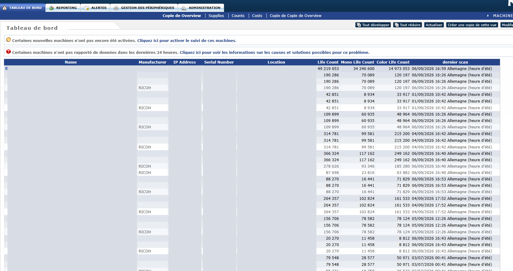

\pagebreak

## 1 Presentation de l'entreprise

Office Management est une entreprise de bureautique et d'informatique qui accompagne des clients professionnels dans la vente, la location, l'installation et la maintenance d'imprimantes, photocopieurs et equipements informatiques. Son activite ne se limite pas a fournir du materiel : elle repose aussi sur la qualite du suivi, la disponibilite des consommables et la rapidite d'intervention.

L'entreprise fonctionne avec une equipe reduite. On y retrouve un technicien informatique, un technicien specialise dans la reparation des imprimantes et photocopieurs, un commercial, une personne responsable de la comptabilite et de la gestion du stock, ainsi que le dirigeant. Cette taille humaine facilite les echanges directs, mais elle rend aussi les processus tres dependants de l'organisation et de la circulation de l'information.

Dans ce type de structure, chaque perte de temps a un impact important. Si une information est difficile a retrouver, si un stock client n'est pas connu ou si une alerte est mal interpretee, cela peut entrainer un appel client inutile, une intervention retardee ou une rupture de consommable. Le besoin de centralisation et de tracabilite est donc directement lie a la performance de l'entreprise.

## 2 Marche et enjeux professionnels

Le marche de la bureautique professionnelle est un marche de service autant qu'un marche de materiel. Les clients attendent que leurs imprimantes soient disponibles, que les consommables arrivent au bon moment et que les pannes soient traitees rapidement. Une imprimante en panne ou sans toner peut bloquer un service administratif, ralentir une activite commerciale ou deranger une organisation client.

Les enjeux metier identifies sont donc multiples : reduire les delais de traitement, eviter les oublis, securiser les informations sensibles, ameliorer la communication entre les services et rendre les taches plus accessibles a plusieurs personnes. L'objectif n'etait pas seulement de faire une application de plus, mais de creer un support fiable pour un processus quotidien.

OMtek s'inscrit dans cette logique. Le projet transforme des informations techniques en decisions metier. Une alerte toner n'est pas seulement un message : elle devient un signal qualifie, relie a une machine, a un site, a un stock et potentiellement a une intervention.

## 3 Situation initiale observee

Avant OMtek, le suivi reposait sur plusieurs supports. Les rapports d'intervention etaient scannes et OCRises dans un dossier partage, certaines ecritures manuscrites etaient difficiles a relire, les consommables etaient suivis dans un tableau Excel et le materiel informatique dans un autre. Certaines informations restaient surtout dans les habitudes ou la memoire des techniciens.

Cette situation pouvait fonctionner lorsque les memes personnes suivaient les memes dossiers, mais elle devenait fragile des qu'une autre personne devait aider ou reprendre une tache. Il fallait alors mener un vrai travail de recoupement : chercher l'information dans Print Audit, verifier le stock, retrouver un rapport, appeler un client ou demander au technicien qui avait l'habitude du site.

Cette dispersion etait l'un des problemes principaux. Elle entrainait une perte de temps, un risque d'erreur et une dependance trop forte a des connaissances non formalisees. Le projet avait donc besoin d'une approche centree sur la centralisation, la lisibilite et la tracabilite.

| Support | Information contenue | Limite observee |
| --- | --- | --- |
| Print Audit | Parc machines, alertes, derniers scans | Interface technique, peu adaptee au mobile et a l'action terrain |
| Rapports scannes | Details d'intervention, compteur, piece changee | Lecture parfois difficile, historique peu exploitable |
| Excel stock | Quantites consommables et materiel | Mise a jour separee du reste du processus |
| Memoire technicien | Contexte client et habitudes terrain | Risque de perte d'information et difficulte de transmission |

## 4 Naissance du projet OMtek

La premiere idee du projet etait simple : regrouper les donnees dans un meme logiciel. Cette idee a ensuite evolue vers une reflexion plus large : comment faire gagner du temps a l'equipe, comment ameliorer l'efficacite et comment recuperer les donnees pour mieux les restituer.

Le plus flou au depart etait la logique metier elle-meme. Avant de coder, il fallait comprendre les contraintes de l'entreprise, les habitudes de travail, les types de pieces, les consommables, les interventions et les informations vraiment utiles. Cette phase d'observation a ete essentielle, car une solution technique mal alignee sur le terrain aurait pu etre rejetee ou inutile.

OMtek a donc ete pense comme un projet progressif : construire d'abord une application web accessible partout, capable de fonctionner avec les flux existants, puis preparer une solution desktop pour fiabiliser la collecte a long terme.

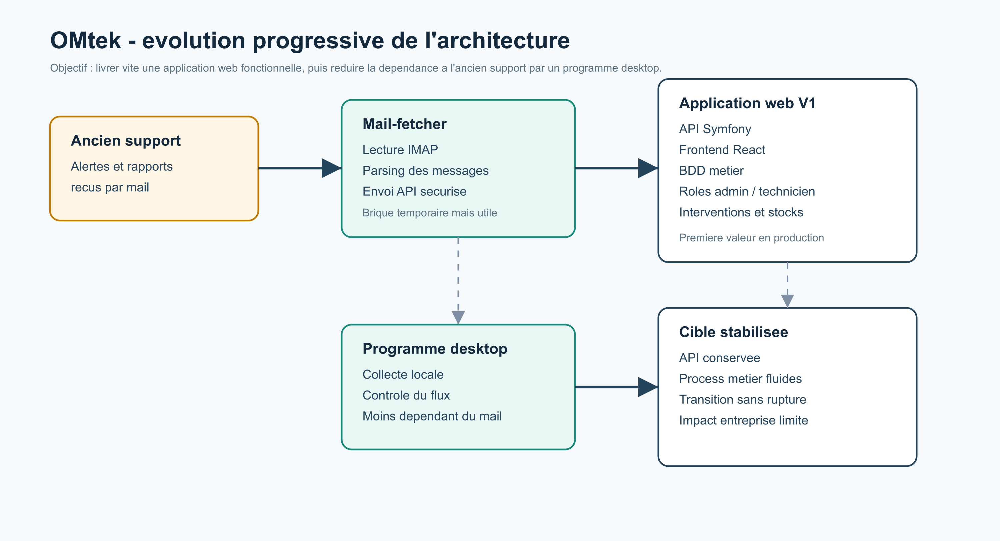

# II Developpement des missions et du projet OMtek

Le developpement du projet OMtek constitue le fil conducteur de ce rapport. Il permet de relier mes missions terrain, l'analyse des besoins, la conception technique, l'UX, la securite et la gestion de projet. Ce projet n'est pas une fonctionnalite isolee : il represente une tentative de transformation progressive d'un processus reel.

Le principe general est le suivant : conserver temporairement les sources existantes, notamment les mails d'alertes et les donnees issues de Print Audit, puis construire une application web qui centralise et qualifie ces informations. Dans un second temps, un programme desktop doit permettre de reduire la dependance a ces supports historiques.

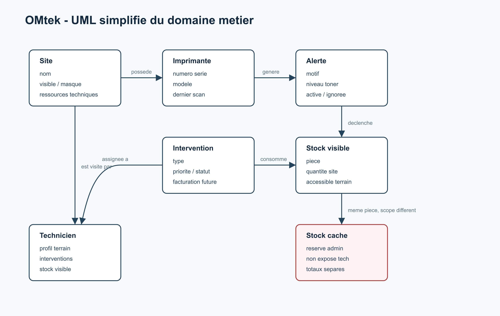

\pagebreak

## 5 Vue d'ensemble des missions

Mes missions ont combine des activites terrain et des activites de developpement. Cette double position a ete importante, car elle m'a permis de comprendre les problemes avant de les transformer en fonctionnalites.

| Mission | Objectif | Resultat |
| --- | --- | --- |
| Installation d'imprimantes | Configurer pilotes, scan SMB ou SMTP, carnets d'adresses | Comprehension directe des contraintes client |
| Intervention terrain | Changer un fusing, verifier un scan SMB, relever un stock toner | Observation du circuit manuel d'information |
| Analyse des processus | Identifier les supports existants et les pertes de temps | Definition du besoin de centralisation |
| Mail-fetcher | Recuperer les alertes sans API officielle | Collecte automatique provisoire |
| Application web | Centraliser sites, machines, alertes, stocks et interventions | V1 fonctionnelle et testable |
| UX mobile | Adapter l'interface au terrain | PWA plus lisible pour les techniciens |
| Projet desktop | Preparer une collecte moins dependante du mail | Perspective de stabilisation |

## 6 Intervention terrain et prise de conscience

Une intervention m'a particulierement aide a comprendre la necessite du projet. Sur site client, j'ai du changer un fusing, verifier l'envoi des scans en SMB pour un utilisateur dont le scan ne fonctionnait plus a cause d'un changement recent de mot de passe, imprimer le compteur de l'imprimante, indiquer la reference de la piece changee, detailler le probleme de scan et relever l'etat des stocks toner chez le client.

Une fois revenu a l'entreprise, j'ai transmis le rapport compteur au technicien. Il l'a traite dans ses fiches personnelles pour son suivi du stock, puis il a numerise le rapport afin qu'il soit disponible dans les rapports de l'annee. Cette situation montre que l'information existait, mais qu'elle suivait un chemin long et partiellement manuel.

Avec OMtek, l'objectif est de transformer ce type d'information en evenement metier : une intervention visible, une piece associee, un stock eventuellement diminue, et une trace exploitable plus tard. Cette experience terrain a donc donne un sens concret au besoin de centralisation.

## 7 Choix d'une application web comme premiere etape

Le choix d'une application web s'est impose pour une raison principale : l'accessibilite. L'outil devait pouvoir etre consulte depuis plusieurs postes, par differents profils, et potentiellement sur mobile en PWA. Une application web permettait aussi de separer clairement le backend, le frontend et le systeme d'ingestion.

Symfony a ete choisi pour l'API, car c'est la technologie avec laquelle je suis le plus a l'aise et parce qu'elle correspond bien a un besoin metier structure : entites, migrations, services, controles d'acces, endpoints et logique serveur. React a ete retenu pour le frontend afin d'obtenir une experience plus fluide, meme si ce n'est pas mon point fort initial. Le resultat en valait l'effort, notamment pour les interactions et l'adaptation mobile.

Cette decision illustre un compromis : commencer par une solution web fonctionnelle pour apporter rapidement de la valeur, plutot que chercher directement une solution parfaite. Le programme desktop est conserve comme evolution, mais il arrive apres la validation du besoin et des parcours.

## 8 Mail-fetcher et contrainte de collecte

La recuperation des donnees a ete l'une des parties les plus difficiles. Au depart, je pensais que l'acces aux donnees serait plus simple. En realite, il n'existait pas d'API REST ou SOAP exploitable pour recuperer directement les informations des sites clients. Les rapports et alertes arrivaient surtout par mail.

Le mail-fetcher en Node.js a donc ete retenu comme solution intermediaire. Cette partie a ete proposee avec l'aide de l'IA, car je ne me sentais pas capable de la realiser seul dans les temps impartis. Meme ainsi, il a fallu effectuer de nombreux ajustements, comprendre les formats de mails, traiter les cas particuliers et faire tourner le processus sur une VM, car l'hebergement mutualise ne permettait pas de l'executer correctement.

Cette contrainte a influence toute l'architecture. Les donnees collectees par mail ne sont pas aussi propres que des donnees issues d'une API. Il fallait donc prevoir des controles, des filtres, des relations avec les imprimantes connues et des regles de dedoublonnage.

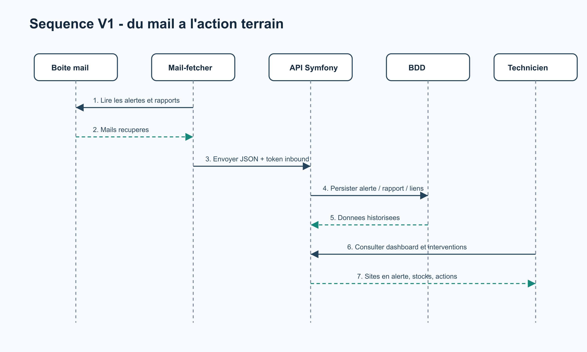

## 9 Logique metier des alertes

La logique des alertes est l'une des parties dont je suis le plus satisfait. Dans l'ancien fonctionnement, une alerte pouvait revenir a chaque scan reseau, parfois toutes les trois heures. Une personne qui suit le systeme en permanence peut s'y retrouver, mais lorsqu'une autre personne doit aider, le manque d'historique et de contexte pousse souvent a rappeler le client pour verifier le stock.

Ce rappel peut etre inutile si le client a deja ete contacte ou si une cartouche a deja ete livree. Il peut aussi donner une image moins professionnelle de l'entreprise. OMtek cherche donc a qualifier les alertes avant de les presenter comme prioritaires.

Une alerte devient actionnable lorsqu'elle represente un risque reel : toner bas ou vide, bac de recuperation plein, niveau inferieur au seuil, stock insuffisant ou situation non couverte. Le systeme doit aussi tenir compte des changements de cartouche et des anciennes alertes devenues obsoletes.

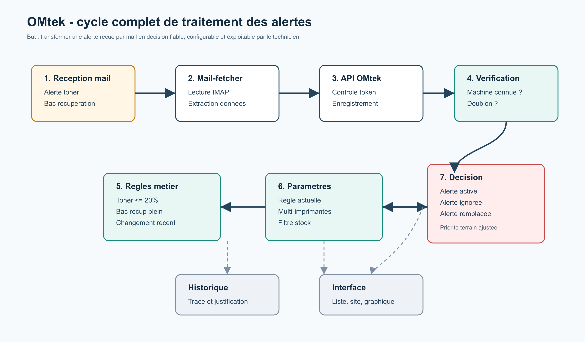

## 10 Parametres et simulation des alertes

Les parametres d'alertes ont ete crees pour tester plusieurs modes de traitement sans modifier le code a chaque fois. Cette decision vient de mon analyse : il fallait pouvoir ignorer certaines alertes afin de gagner du temps, tout en evitant de masquer une alerte importante.

La difficulte vient du fait que le seuil d'une imprimante seule n'a pas le meme sens que celui d'un site avec plusieurs imprimantes utilisant la meme cartouche. Une imprimante a 20 % avec une cartouche en stock peut etre une situation acceptable. En revanche, six imprimantes a 20 % avec seulement deux cartouches disponibles peuvent representer un probleme serieux. Cette reflexion a conduit a une logique de score et de comparaison avec le stock.

La logique est actuellement testee en conditions reelles et comparee a l'ancien systeme afin de rassurer l'equipe et de mesurer le gain apporte. Cette prudence est importante, car une alerte ignoree a tort peut creer un risque pour l'entreprise.

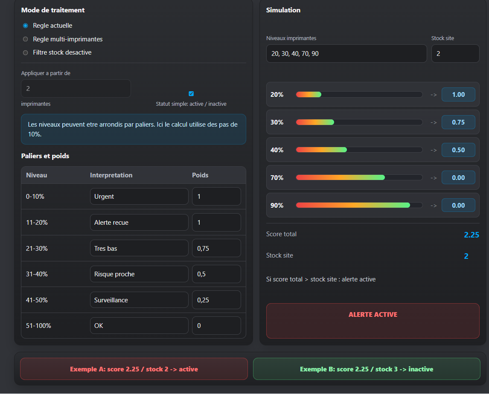

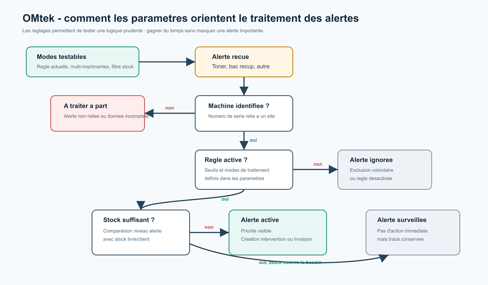

## 11 De l'alerte brute a l'alerte qualifiee

Un des avantages majeurs d'OMtek est de transformer une alerte brute en alerte qualifiee. Une alerte brute indique seulement un fait technique. Une alerte qualifiee indique si ce fait demande une action, s'il est deja couvert par le stock, s'il est lie a une machine connue ou s'il doit etre ignore ou surveille.

Cette qualification reduit la charge mentale. Le technicien ne doit plus effectuer seul tous les recoupements. L'application lui presente une information plus claire, avec un statut et un contexte. Cela rend aussi les taches plus abordables pour une personne qui n'est pas impliquee en permanence dans le suivi des alertes.

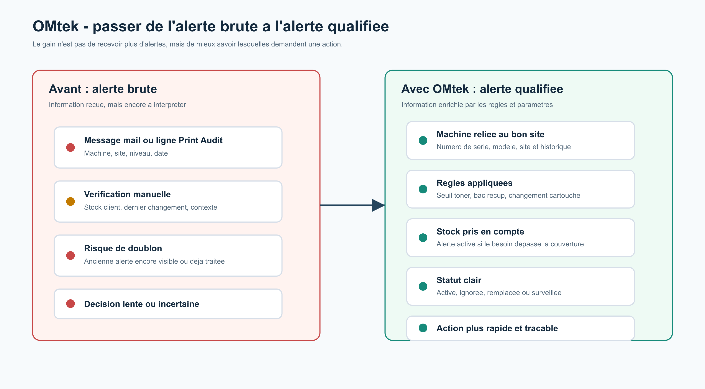

## 12 Graphique de consommation toner

Le graphique de consommation toner apporte une valeur forte, car il regroupe dans une meme lecture l'historique, la date du jour, la simulation prudente, les changements de cartouche et les interventions. Ce n'est pas seulement un element visuel : c'est un outil d'aide a la decision.

Dans l'ancien fonctionnement, il fallait recouper le niveau toner, le dernier rapport, le stock client, les interventions et les informations du technicien. Avec le graphique, l'utilisateur peut comprendre plus rapidement pourquoi le niveau a baisse, si une cartouche a ete changee, si une intervention a eu lieu et si le stock doit etre ajuste.

Cette visualisation permet aussi de mieux expliquer la logique au dirigeant et aux techniciens. Elle donne une preuve visuelle de l'interet du projet et rend les gains plus faciles a percevoir.

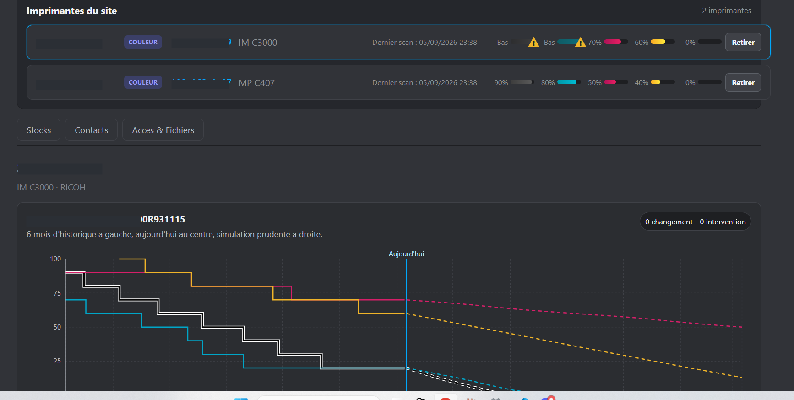

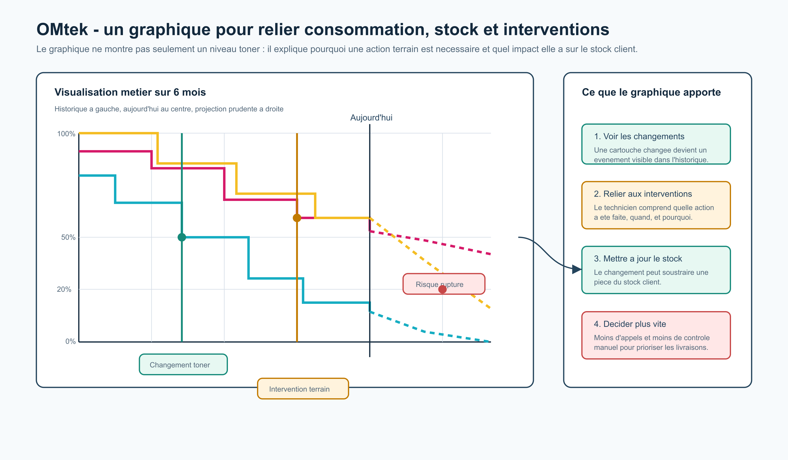

## 13 Changement de cartouche et stock client

Lorsqu'une cartouche est changee, l'information doit avoir une consequence dans le stock client. L'objectif est de ne plus avoir une information seulement presente dans un rapport scanne, mais un evenement exploitable : date, machine, piece concernee, stock avant, sortie et stock apres.

Ce lien entre changement de cartouche et stock client est essentiel pour reduire les appels de verification. Si le systeme sait qu'une cartouche a ete utilisee et que le stock a ete diminue, l'equipe peut mieux anticiper la prochaine livraison. Cela donne aussi plus de coherence entre le terrain et l'administration.

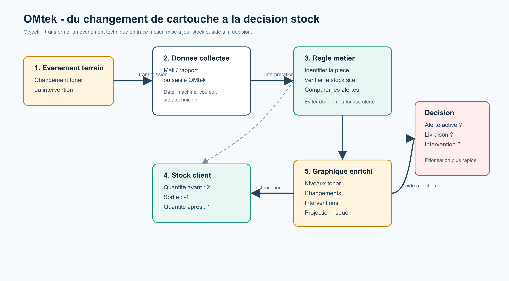

## 14 Interventions et tracabilite

L'ajout des interventions transforme OMtek en outil operationnel. Une alerte ou une situation terrain peut etre reliee a une action : livraison toner, depannage, telemaintenance ou intervention manuelle. L'intervention porte un statut, une priorite, une source, des notes et des informations preparees pour une future exploitation administrative ou comptable.

Cette partie repond a un manque observe dans l'ancien fonctionnement : l'historique etait present, mais pas assez structure. Les rapports scannes existaient, mais ils ne permettaient pas toujours de suivre facilement les decisions, les actions et les consequences sur le stock. OMtek apporte donc une tracabilite plus lisible.

La difficulte a ete de construire un modele suffisamment complet sans rendre la V1 trop lourde. Certaines parties, comme la facturation avancee, restent preparees mais non centrales dans la premiere version.

## 15 Gestion des stocks visibles et caches

La gestion du stock a demande une attention particuliere. Il fallait distinguer le stock visible par les techniciens et le stock cache reserve a l'administrateur. Cette regle existe pour des raisons de controle interne : le gerant conserve un stock a part, qu'il souhaite suivre lui-meme, notamment parce que des problemes de vol ont deja existe par le passe.

Cette contrainte a une consequence technique importante : il ne suffit pas de masquer le stock cache dans l'interface. La regle doit etre appliquee cote API pour eviter toute fuite dans les listes, les totaux, les exports ou les donnees recues par le frontend. Cette partie m'a fait progresser sur la difference entre affichage et securite.

Pour le technicien, l'objectif est de voir le stock utile a son action. Pour l'administrateur, l'objectif est de garder la vision complete, y compris les reserves. Cette separation permet de respecter les roles sans bloquer le travail terrain.

## 16 UX mobile et retours technicien

Les retours technicien ont surtout concerne la visibilite des informations prioritaires. Certaines donnees devaient etre placees plus haut dans les pages, car le technicien doit agir rapidement. Le mobile en taille proche d'un Samsung S22 a ete l'un des formats les plus difficiles, car les tableaux de pieces et les donnees techniques sont difficiles a afficher sur un petit ecran.

Cette contrainte a pousse a trier strictement les informations essentielles. Il fallait eviter de reproduire sur mobile une interface de bureau trop dense. Les techniciens doivent pouvoir agir chez le client lorsqu'ils livrent, depannent ou controlent un stock. La PWA devait donc etre lisible, rapide et orientee action.

Le travail UX montre que la qualite d'une application metier ne se limite pas a ses fonctionnalites. Une information correcte mais mal placee peut rester inutilisable. Inversement, une information bien hierarchisee peut faire gagner du temps et reduire les erreurs.

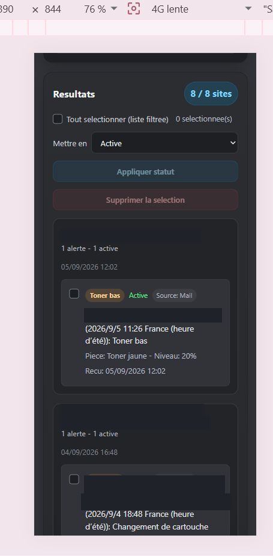

## 17 Securite et priorisation des fonctionnalites

La priorisation du projet a commence par la securite. Les donnees concernent des clients professionnels, notamment des structures sensibles comme des offices notariaux. Il fallait donc securiser les acces avant d'ajouter des fonctionnalites plus avancees.

Ensuite, j'ai priorise la validite des donnees metier : collecte, centralisation, stockage et visualisation. Une fois cette base presente, les priorites ont porte sur les alertes, la gestion des stocks, les sites et les interventions. Cette progression a permis de construire un socle avant d'ajouter des reglages plus fins.

Cette methode m'a aussi aide a gerer les changements de demande. Chaque partie a ete pensee pour permettre un retour en arriere via Git si un changement devenait trop important ou si une decision devait etre corrigee.

## 18 Chronologie du projet

| Periode | Phase | Objectif |
| --- | --- | --- |
| Septembre - octobre 2025 | Prise en main du poste | Comprendre le metier, les outils et les besoins |
| Novembre - decembre 2025 | Collecte et premiere conception | Explorer les donnees et tester la recuperation |
| Janvier - avril 2026 | Conception avancee | Construire la premiere version avant test |
| Mai - juillet 2026 | Pause projet | Gerer les imperatifs scolaires et conserver le fil |
| Aout 2026 | Premiers retours | Adapter l'UX et les informations prioritaires |
| Septembre - octobre 2026 | Stabilisation | Tester en reel et corriger legerement |
| Novembre - decembre 2026 | Projet desktop | Preparer une collecte moins dependante du mail |

Cette chronologie montre une progression iterative. Le projet n'a pas suivi un chemin parfaitement lineaire : il a fallu apprendre, construire, interrompre, reprendre, tester et ajuster. La pause entre mai et juillet m'a montre l'importance de documenter pour pouvoir reprendre un projet long sans perdre le fil.

## 19 Comparaison avant et apres OMtek

La comparaison entre l'ancien fonctionnement et OMtek montre la vraie valeur du projet. Avant, les informations existaient mais elles etaient dispersees. Avec OMtek, elles sont regroupees autour d'un parcours metier : alerte, verification, stock, intervention et historique.

Ce changement est important pour l'entreprise, car il rend les taches plus transmissibles. Une personne qui n'a pas suivi un dossier depuis le debut peut comprendre plus rapidement la situation. C'est aussi une facon de preparer l'entreprise a une croissance future, sans que toute l'organisation repose uniquement sur la memoire des personnes deja presentes.

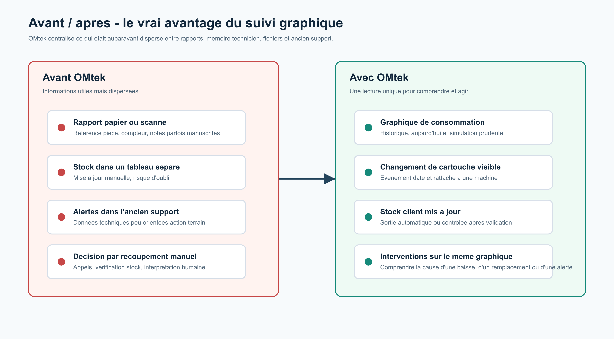

## 20 Approfondissement des processus metier

Pour comprendre l'interet d'OMtek, il faut detailler le fonctionnement d'une tache apparemment simple : traiter une alerte toner. Dans l'ancien fonctionnement, cette action pouvait demander plusieurs verifications. Il fallait d'abord identifier le site concerne, verifier la machine et son numero de serie, consulter l'ancien support, regarder si un rapport recent existait, controler le stock connu et parfois appeler le client. Une alerte ne donnait donc pas directement une action ; elle declenchait une enquete.

Cette enquete etait supportable lorsque la personne connaissait parfaitement le parc et suivait les alertes tous les jours. En revanche, elle devenait beaucoup plus difficile lorsqu'une autre personne devait prendre le relais. Le risque etait alors de refaire des controles deja realises, de rappeler un client deja contacte, ou de ne pas savoir si une cartouche avait deja ete livree. Ce probleme n'etait pas uniquement technique : il concernait la transmission de l'information dans l'entreprise.

OMtek cherche a reduire cette dependance a la memoire individuelle. L'application relie les informations entre elles : une machine appartient a un site, un modele possede des pieces compatibles, une alerte correspond a un niveau ou a un motif, un stock peut couvrir ou non le besoin, une intervention peut expliquer une action realisee. Le role du logiciel est donc de transformer un ensemble de signaux disperses en une lecture commune.

Cette logique est importante dans une PME, car les effectifs sont limites. Chaque personne a plusieurs responsabilites et il n'est pas toujours possible de consacrer beaucoup de temps a la recherche d'information. Si l'application permet de gagner quelques minutes sur chaque verification, le gain devient important sur l'ensemble des alertes et des interventions.

Le projet m'a aussi fait comprendre que la centralisation ne suffit pas. Il ne faut pas seulement mettre toutes les donnees au meme endroit ; il faut les organiser selon le besoin reel. Une page remplie d'informations peut etre aussi difficile a utiliser qu'un dossier mal range. C'est pour cette raison que les retours technicien sur la priorisation des informations en haut de page ont ete importants.

La valeur du logiciel se trouve donc dans l'articulation entre trois elements : la collecte des donnees, leur qualification metier et leur restitution ergonomique. Si l'un des trois manque, le systeme perd de son interet. Une collecte sans qualification cree du bruit. Une qualification sans interface claire reste difficile a utiliser. Une belle interface sans donnees fiables ne resout pas le probleme.

## 21 Scenarios utilisateurs et parcours cibles

J'ai progressivement distingue plusieurs scenarios utilisateurs. Le premier concerne le technicien qui consulte les alertes avant ou pendant sa tournee. Il doit savoir quels sites demandent une attention, quelles machines sont concernees, quel consommable pose probleme et si le stock client permet d'attendre ou non. Son besoin principal est la rapidite de lecture.

Le deuxieme scenario concerne le technicien qui revient d'une intervention. Il doit pouvoir laisser une trace : probleme observe, piece changee, compteur imprime, stock verifie, action realisee. Dans l'ancien fonctionnement, ces informations passaient par un rapport papier ou scanne. OMtek doit permettre de transformer ce retour en donnee exploitable, reliee au site et a la machine.

Le troisieme scenario concerne l'administrateur ou le dirigeant. Son besoin est different. Il doit garder une vision plus complete : stocks visibles, stocks caches, sites masques, logique d'alertes, parametres, historique et futures informations de facturation. Il a besoin de controle, mais aussi d'indicateurs pour comprendre si le processus fonctionne.

Le quatrieme scenario concerne l'equipe commerciale ou administrative. Meme si ces profils ne sont pas toujours au coeur de l'action technique, ils beneficient d'une information mieux structuree. Savoir qu'une intervention est en cours, qu'un stock est faible ou qu'un client a deja ete contacte peut eviter des incomprehensions entre services.

Ces scenarios montrent pourquoi une seule interface uniforme n'aurait pas suffi. L'application devait proposer une information commune, mais adaptee selon les roles. Le technicien doit etre guide vers l'action ; l'administrateur doit pouvoir superviser ; les autres services doivent pouvoir comprendre l'etat du suivi sans entrer dans toute la complexite technique.

Cette reflexion m'a aide a mieux comprendre la notion de parcours utilisateur. Avant ce projet, j'avais tendance a penser en termes de pages et de fonctionnalites. Avec OMtek, j'ai compris qu'une fonctionnalite n'a de valeur que si elle s'inscrit dans une situation d'usage concrete : avant une intervention, pendant une intervention, apres une intervention ou lors d'une verification administrative.

## 22 Conception du modele de donnees

La conception du modele de donnees a ete l'une des parties les plus structurantes. Il fallait creer un lien coherent entre des objets metier qui, dans l'ancien fonctionnement, etaient souvent separes : sites, imprimantes, modeles, pieces, stocks, alertes, rapports et interventions. Chaque relation devait avoir un sens concret.

Le lien entre modele d'imprimante et piece est essentiel. Un technicien peut parler d'une ancienne reference par habitude, mais le logiciel doit conserver une reference fiable et exploitable. Cela m'a oblige a penser la notion de correspondance entre les references utilisees sur le terrain et les references reelles en base. Le logiciel ne doit pas effacer l'habitude du technicien ; il doit la traduire en information plus stable.

Le lien entre alerte et imprimante est aussi important. Une alerte recue par mail n'est utile que si elle peut etre reliee a une machine connue. Sinon, elle reste une information incomplete. Cela explique les controles mis en place lors de la reception : numero de serie, machine existante, site associe, motif d'alerte et risque de doublon.

Le stock a ajoute une difficulte supplementaire. Il ne s'agit pas seulement d'une quantite. Il existe un stock client, un stock entreprise, un stock visible par le technicien et un stock cache reserve a l'administrateur. Le modele de donnees doit permettre cette distinction sans melanger les roles ni fausser les totaux.

Les interventions servent de point de liaison entre l'observation et l'action. Une intervention peut expliquer pourquoi un niveau toner change, pourquoi une piece sort du stock ou pourquoi une alerte n'est plus prioritaire. En structurant cette information, OMtek transforme les actions terrain en historique exploitable.

Avec le recul, cette partie aurait merite encore plus de temps au debut. Certaines notions de conception ont ete vues plus tard dans la formation, alors que le projet etait deja avance. Cela m'a fait comprendre qu'une bonne base de donnees conditionne fortement la qualite du reste de l'application.

## 23 Risques metier et mesures de prudence

Le projet comporte plusieurs risques metier. Le premier est le risque de masquer une alerte qui aurait du rester active. C'est pour cette raison que les parametres d'alertes sont testes progressivement et compares avec l'ancien systeme. Le gain de temps ne doit pas se faire au detriment de la fiabilite.

Le deuxieme risque concerne la confiance des utilisateurs. Si le logiciel est percu comme un outil de surveillance, il peut etre mal accepte. Il fallait donc insister sur sa finalite : aider a mieux suivre les stocks, eviter les oublis, limiter les appels inutiles et partager les informations importantes. La difference entre aide au travail et controle des personnes est un point sensible.

Le troisieme risque concerne les donnees client. Les informations de connexion, les sites, les rapports et les historiques doivent etre traites avec prudence. La presence de clients sensibles, comme des notaires, renforce cette exigence. Cela explique la priorisation de la securite et des roles dans le projet.

Le quatrieme risque concerne la dependance technique au mail-fetcher. Cette solution a permis d'avancer, mais elle reste intermediaire. Un changement de format de mail, un probleme de boite ou une indisponibilite de la VM peut perturber la collecte. La perspective desktop repond en partie a cette limite.

Le cinquieme risque est organisationnel. Une application peut etre techniquement fonctionnelle mais rester peu utilisee si elle ne correspond pas aux habitudes ou si elle demande trop d'efforts au quotidien. Les retours terrain et les corrections legeres sont donc indispensables avant une generalisation.

Ces risques ne sont pas des echecs du projet. Au contraire, les identifier montre une capacite de recul. Une solution professionnelle doit etre pensee avec ses limites, ses conditions d'adoption et ses points de controle.

## 24 Tests retours et amelioration continue

La phase de test est essentielle, car elle permet de confronter la conception a la realite. Depuis septembre 2026, une version fonctionnelle est testee en conditions reelles avec un technicien. Cette etape permet d'observer ce qui fonctionne, ce qui manque et ce qui doit etre simplifie.

Les premiers retours ont porte sur la visibilite des informations importantes, notamment sur mobile. Cela confirme que l'ergonomie ne peut pas etre definie uniquement depuis le poste de developpement. Une interface qui parait claire sur un ecran large peut devenir moins efficace sur un telephone pendant une intervention.

Les reglages d'alertes sont egalement en test. Leur objectif est de gagner du temps, mais ils doivent etre compares avec l'ancien systeme pour eviter une erreur de logique. Cette comparaison permet d'avancer avec prudence et de rassurer la direction comme les techniciens.

L'amelioration continue repose sur de petites corrections plutot que sur une refonte brutale. Cette approche correspond mieux au contexte de l'entreprise. Elle permet de montrer rapidement des progres, de prendre en compte les remarques et de garder un outil utilisable pendant son evolution.

Cette phase m'a appris qu'un projet n'est jamais vraiment termine au moment ou le code fonctionne. Le vrai test commence lorsque les utilisateurs essaient de l'integrer dans leur journee de travail. C'est a ce moment que les priorites deviennent plus claires.

Pour la suite, il faudra renforcer les tests automatises, stabiliser la mise en production et continuer a mesurer les gains. Les corrections devront rester tracees afin de conserver une vision claire de l'evolution du projet.

## 25 Accompagnement du changement dans l'entreprise

Un aspect important du projet ne concerne pas directement le code, mais l'acceptation du changement. OMtek modifie des habitudes de travail installees depuis longtemps. Meme si l'objectif est de faciliter les taches, un nouveau logiciel peut d'abord etre percu comme une contrainte supplementaire. Il faut apprendre a l'utiliser, changer certaines procedures et accepter que des informations autrefois conservees individuellement deviennent partagees.

Cette situation a ete delicate, car les salaries peuvent se montrer mefiants face a un outil qui centralise davantage les donnees. Certains peuvent craindre que le logiciel serve a prouver une mauvaise gestion de leur part, a verifier leurs deplacements, a surveiller leur temps d'intervention ou a controler leur maniere de travailler. Meme lorsque ce n'est pas l'objectif du projet, cette perception doit etre prise au serieux, car elle influence directement l'adoption de l'outil.

Pour l'equipe technique, le changement touche aussi a l'identite professionnelle. Un technicien connait ses sites, ses habitudes, ses anciennes references de pieces et ses methodes de suivi. Lorsque le logiciel propose une reference officielle, une alerte qualifiee ou une sortie de stock automatisee, il peut donner l'impression de remplacer une expertise humaine. Il fallait donc montrer que le but etait au contraire de rendre cette expertise plus visible et plus transmissible.

La direction, de son cote, reste attachee a certaines procedures existantes. Ces procedures ont permis a l'entreprise de fonctionner jusque-la, meme avec leurs limites. Les modifier demande donc de la prudence. Il ne suffit pas d'expliquer qu'un nouveau processus est plus efficace : il faut prouver qu'il respecte les contraintes de l'entreprise, qu'il limite les risques et qu'il ne bloque pas le travail quotidien.

C'est pour cette raison que j'ai privilegie une transition progressive. Le logiciel web fonctionne d'abord en comparaison avec l'ancien support. Les alertes parametrees sont testees en conditions reelles, mais l'ancien systeme reste disponible comme point de controle. Cette double lecture permet de rassurer les utilisateurs : OMtek ne remplace pas brutalement les pratiques, il les structure et les rend plus fiables.

La conduite du changement passe aussi par le choix des mots. Pour presenter OMtek, il est preferable de parler de gain de temps, de reduction des oublis, de securisation des donnees client et de meilleure transmission des informations, plutot que de controle ou de surveillance. Cette nuance est importante, car un logiciel metier peut etre accepte ou rejete selon la maniere dont il est explique.

Les retours technicien ont montre que l'adoption passe par des details tres concrets. Une information placee trop bas dans une page peut donner l'impression que l'application complique le travail. Une vue mobile mal adaptee peut confirmer la mefiance initiale. A l'inverse, une alerte claire, un graphique lisible ou une information prioritaire en haut de page permettent de montrer rapidement l'interet du nouvel outil.

Cette dimension humaine m'a appris qu'un developpeur ne doit pas seulement chercher la solution techniquement juste. Il doit aussi comprendre les craintes, les habitudes et les contraintes des personnes qui utiliseront l'application. Dans une PME, la relation de confiance est essentielle : si les utilisateurs pensent que l'outil est fait contre eux, il sera difficile a deployer, meme s'il fonctionne bien techniquement.

Avec le recul, cette partie du projet represente un apprentissage majeur. Concevoir OMtek, ce n'etait pas seulement creer une base de donnees, un frontend et un mail-fetcher. C'etait aussi accompagner une evolution des pratiques, expliquer les choix, accepter les remarques, rassurer les utilisateurs et avancer suffisamment lentement pour ne pas casser ce qui fonctionne deja.

## 26 Gains attendus et indicateurs de reussite

Pour que le projet soit accepte, il ne suffit pas de dire que l'application est plus moderne. Il faut pouvoir expliquer les gains attendus de maniere concrete. Le premier gain concerne le temps de recherche d'information. Avant OMtek, une personne pouvait devoir consulter plusieurs supports pour comprendre une alerte : ancien tableau, rapport scanne, fichier de stock, information connue par le technicien. Avec OMtek, ces informations sont progressivement rassemblees autour du site, de l'imprimante et de l'alerte.

Le deuxieme gain concerne la reduction des appels inutiles aux clients. Lorsqu'une alerte revient regulierement, la tentation est de rappeler le client pour verifier s'il reste du toner ou si une livraison est necessaire. Si l'application indique qu'un stock client est disponible, qu'une cartouche a ete recemment changee ou qu'une intervention est deja creee, l'equipe peut eviter de deranger le client inutilement. Ce point est important pour l'image professionnelle de l'entreprise.

Le troisieme gain concerne la tracabilite. Une intervention terrain produit beaucoup d'informations : probleme constate, piece changee, compteur, stock observe, action realisee. Si ces informations restent dans un rapport scanne ou dans la memoire d'une personne, elles sont difficiles a exploiter. Si elles sont reliees dans OMtek, elles peuvent servir plus tard a comprendre une situation, anticiper une livraison ou justifier une decision.

Le quatrieme gain concerne la transmission interne. Dans une petite equipe, chacun connait une partie du fonctionnement, mais cette connaissance n'est pas toujours formalisee. OMtek permet de rendre les taches plus partageables. Un technicien, un responsable ou une personne administrative peut retrouver plus facilement l'etat d'un site sans demander systematiquement a la personne qui suit habituellement le dossier.

Le cinquieme gain concerne la securite et le controle. La distinction entre stock visible et stock cache donne au dirigeant un moyen de suivre une reserve sans l'exposer a tous les utilisateurs. De la meme maniere, la separation des roles permet de donner a chacun l'information necessaire sans ouvrir des donnees sensibles comme la comptabilite ou certains stocks.

Pour evaluer la reussite du projet, plusieurs indicateurs peuvent etre suivis pendant les tests : nombre d'alertes vraiment actionnables, temps moyen pour comprendre une alerte, nombre d'appels client evites, nombre d'interventions creees depuis une alerte, coherence entre changement de cartouche et sortie de stock, retours technicien sur mobile et nombre de corrections demandees apres usage reel.

Ces indicateurs montrent que la reussite d'OMtek ne se mesure pas seulement au nombre de fonctionnalites developpees. Elle se mesure surtout a la capacite du logiciel a simplifier le travail quotidien, a reduire les incertitudes et a rendre les informations plus fiables pour l'ensemble de l'entreprise.

# III Analyse reflexive et bilan de competences

Cette partie prend du recul sur l'experience. Le projet OMtek ne doit pas etre presente uniquement comme une suite de fonctionnalites. Il m'a surtout permis de progresser dans ma facon d'analyser un besoin, de gerer une contrainte, de communiquer avec des utilisateurs et de relier la technique a un usage concret.

Le principal apprentissage est que le developpement d'une application metier demande autant de comprehension humaine que de competence technique. Il faut ecouter, observer, tester, expliquer et accepter de revoir certaines decisions.

\pagebreak

## 27 Autonomie

L'autonomie s'est manifestee dans la conception du systeme d'alertes. Il a fallu imaginer une logique capable de prendre en compte les seuils de criticite, le nombre d'imprimantes et le stock disponible. Le cas d'un site avec une seule imprimante n'a pas le meme niveau de risque qu'un site avec six imprimantes utilisant la meme cartouche.

Cette reflexion n'etait pas donnee directement. Elle vient de l'observation du terrain et de la comprehension progressive du metier. J'ai du proposer une logique, la rendre configurable, puis la tester en conditions reelles pour eviter de prendre une decision trop risquee.

Cette autonomie a aussi existe dans la recherche de solutions de collecte. Face a l'absence d'API, j'ai du accepter une solution intermediaire, comprendre ses limites et preparer une evolution desktop.

## 28 Adaptation

L'adaptation a ete necessaire face aux habitudes de l'entreprise. Le technicien utilisait parfois d'anciennes references pour nommer des toners ou des pieces detachees. Par exemple, une reference de toner pouvait etre appelee avec une ancienne denomination, alors que la reference reelle appartenait a un autre modele. Il a donc fallu adapter le logiciel pour afficher la reference correcte et les correspondances utiles.

L'adaptation a egalement concerne l'acceptation du changement. Le personnel n'etait pas forcement pret a modifier ses habitudes. La solution devait donc prouver sa valeur progressivement, en conservant l'ancien systeme comme comparaison et en proposant une interface suffisamment claire pour obtenir des retours.

Cette experience m'a appris qu'un projet ne reussit pas uniquement parce qu'il est techniquement possible. Il doit aussi respecter le rythme de l'entreprise et les habitudes des utilisateurs.

## 29 Communication professionnelle

La communication a ete importante pour expliquer les choix techniques simplement. Le systeme d'alertes, par exemple, etait difficile a expliquer au dirigeant parce qu'il fallait montrer pourquoi l'ancien suivi devenait complique pour une personne qui n'etait pas impliquee en permanence.

J'ai du reformuler le probleme en termes metier : trop d'alertes redondantes, trop d'appels clients inutiles, manque d'historique clair et besoin de rendre la tache accessible aux futurs employes. Cette facon d'expliquer a permis de relier la complexite technique a un gain concret pour l'entreprise.

Les graphiques et captures ont joue un role dans cette communication. Ils permettent de montrer visuellement les avantages : alertes qualifiees, stocks pris en compte, changements de cartouche visibles et interventions reliees a l'historique.

## 30 Rigueur et securite

La rigueur a ete essentielle dans la conception de la base de donnees. Il fallait eviter de perdre certaines informations a cause de mauvaises relations ou de suppressions en cascade mal pensees. Une application metier doit conserver les traces importantes, surtout lorsqu'elles concernent des interventions, des stocks ou des clients.

La securite des roles m'a aussi oblige a etre precis. Les stocks caches et la partie comptabilite ne doivent pas etre visibles par les techniciens. Cette regle devait etre appliquee cote API, pas seulement dans le frontend. Ce point m'a fait progresser sur la maniere de penser une application reelle, exposee a des utilisateurs differents.

La rigueur concerne enfin les alertes. Une regle mal calibree peut faire gagner du temps au debut mais creer un risque plus tard. C'est pourquoi les parametres sont testes et compares avec l'ancien fonctionnement avant validation complete.

## 31 Gestion du temps et organisation

Le projet a ete difficile a organiser, car il s'est deroule en parallele des missions en entreprise, des cours, des rendus scolaires et de ma vie personnelle. Une partie du travail a ete realisee le soir ou sur des temps disponibles, ce qui a demande de la discipline.

J'ai compris l'importance de tenir une liste de taches et de documenter meme lorsque je travaille seul. Sans documentation, un projet long devient difficile a reprendre apres une pause. Cette prise de conscience a ete renforcee pendant la periode de mai a juillet 2026, lorsque le projet a ete mis en pause pour des imperatifs scolaires.

Avec le recul, je me disperserais moins. Je definirais plus tot un perimetre de V1 tres clair, puis je documenterais chaque decision au moment ou elle est prise.

## 32 Difficultes techniques

La principale difficulte technique a ete la recuperation des donnees. Je pensais au depart pouvoir les obtenir plus simplement. L'absence d'API exploitable a rendu le mail-fetcher necessaire, mais cette solution a amene d'autres problemes : parsing, formats variables, execution sur VM et fiabilite du flux.

Les filtres d'alertes ont aussi ete complexes. Ils ont cree plusieurs problemes fonctionnels avant d'etre mieux stabilises. Il fallait gerer les seuils, les doublons, les anciennes machines, les changements de cartouche et le lien avec le stock.

Ces difficultes m'ont pousse a mieux comprendre l'importance de la conception. Les bases de conception ont ete vues relativement tard par rapport au demarrage du projet. Avec plus de recul, j'aurais consacre davantage de temps a cette phase avant d'avancer dans les fonctionnalites.

## 33 Difficultes humaines et acceptation du changement

Une autre difficulte a ete l'acceptation du changement. Le dirigeant aime que les choses soient faites rapidement et selon sa maniere de fonctionner. J'ai du apprendre a prendre sur moi, a expliquer les contraintes techniques et a ne pas seulement executer des directives sans recul.

Cette situation m'a appris la patience et la communication. Il fallait faire comprendre qu'une application fiable demande de l'analyse, des tests et parfois du temps. Aller trop vite peut donner l'impression d'avancer, mais peut aussi creer des erreurs plus difficiles a corriger ensuite.

Les retours des techniciens ont ete utiles pour ajuster l'ergonomie. Ils ont montre que certaines informations devaient etre visibles plus haut dans la page et que l'usage mobile devait etre prioritaire pour les actions terrain.

## 34 Ce qui a bien fonctionne

L'approche progressive a bien fonctionne. En conservant temporairement Print Audit et le flux mail, OMtek a pu etre teste sans perturber brutalement l'entreprise. Cette strategie a permis de comparer les resultats avec l'ancien fonctionnement et de rassurer les utilisateurs.

La mise en place des graphiques et des parametres d'alertes a aussi ete un point fort. Ces elements rendent visible la logique metier et montrent que l'application ne se limite pas a afficher des donnees. Elle aide a comprendre, prioriser et decider.

Le projet m'a enfin permis de relier mes apprentissages scolaires a une situation reelle. Les cours de conception, de developpement web et les notions futures autour du desktop ou du SNMP ont nourri la suite du projet.

## 35 Ce que j'aurais pu anticiper

J'aurais pu anticiper davantage la complexite des donnees. Dans un exercice scolaire, les donnees sont souvent propres et structurees. Dans l'entreprise, elles etaient issues de mails, de rapports, de tableaux et d'habitudes humaines. Cette difference a ete tres formatrice.

J'aurais aussi pu impliquer plus tot les utilisateurs finaux dans les choix d'ergonomie. Les retours technicien ont montre que certaines decisions visuelles auraient pu etre ajustees plus rapidement si elles avaient ete testees plus tot.

Enfin, j'aurais pu separer plus strictement ce qui appartenait a la V1 et ce qui devait rester pour plus tard. Le projet etant vaste, la tentation de traiter trop de sujets a la fois etait forte.

## 36 Bilan personnel

Je suis particulierement satisfait du systeme de gestion des alertes. C'est la partie qui montre le mieux la transformation d'une information brute en logique metier. Elle m'a demande de l'autonomie, de la reflexion et une comprehension fine du terrain.

Ce projet confirme que j'aime creer des solutions numeriques, les penser, les realiser et montrer aux autres les gains qu'elles peuvent apporter. Le fait de voir une idee prendre forme dans une application utile est tres gratifiant.

J'ai developpe des competences techniques en conception, backend, frontend, recuperation de donnees, securite et architecture. J'ai aussi progresse humainement : patience, adaptation, remise en question, communication et organisation.

Les competences a renforcer restent nombreuses : outils UML professionnels, tests automatises, documentation continue, mise en production robuste et developpement desktop. Mais ces axes d'amelioration sont maintenant plus clairs grace au projet.

# IV Conclusion et perspectives

Cette experience m'a permis de passer d'une vision scolaire du developpement a une vision plus professionnelle. OMtek n'est pas seulement une application technique : c'est une reponse progressive a un probleme d'organisation, de suivi et de communication dans une entreprise reelle.

Le projet a commence par l'observation d'un fonctionnement disperse, puis il a evolue vers une application web capable de centraliser les sites, les imprimantes, les alertes, les stocks et les interventions. Les graphiques, les parametres d'alertes et la PWA montrent que le travail a cherche a rendre l'information exploitable, pas seulement disponible.

La principale perspective est le programme desktop. Son objectif sera de reduire la dependance au mail-fetcher et a l'ancien support, en s'appuyant davantage sur une collecte locale et sur des mecanismes comme le SNMP. Cette evolution doit rester progressive pour ne pas perturber l'entreprise.

A titre personnel, ce projet confirme mon interet pour le developpement d'applications metier. J'aime comprendre un probleme concret, concevoir une solution, la rendre utilisable et accompagner son adoption. C'est dans cette direction que je souhaite continuer a progresser.

\pagebreak

# Annexes

Les annexes suivantes ne sont pas a compter dans les trente pages minimales du rapport. Elles servent a appuyer visuellement l'analyse et a montrer la logique du projet.

- Annexe 1 : architecture progressive web puis desktop.
- Annexe 2 : modele de domaine simplifie.
- Annexe 3 : sequence mail-fetcher vers API.
- Annexe 4 : cycle de traitement des alertes.
- Annexe 5 : parametres d'alertes.
- Annexe 6 : graphique de consommation et interventions.
- Annexe 7 : flux changement de cartouche et stock client.
- Annexe 8 : captures anonymisees de l'application.

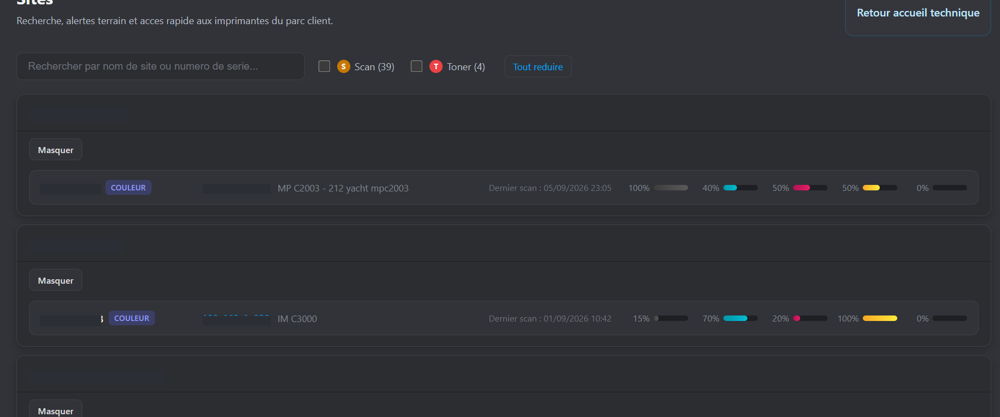

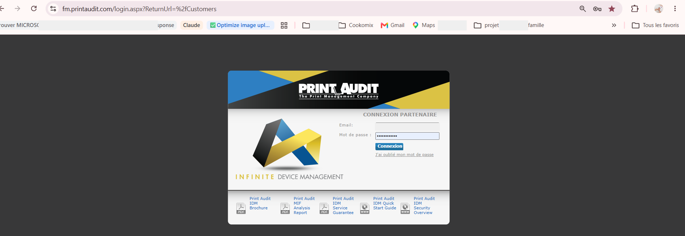

\pagebreak
